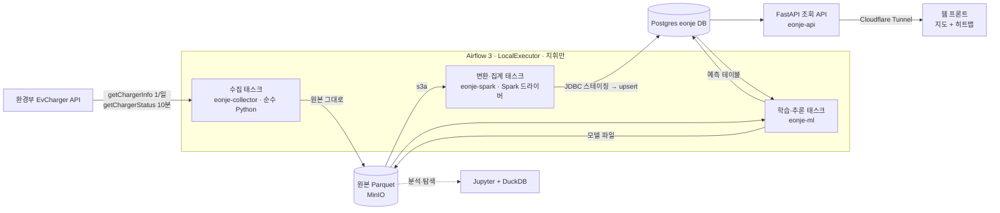
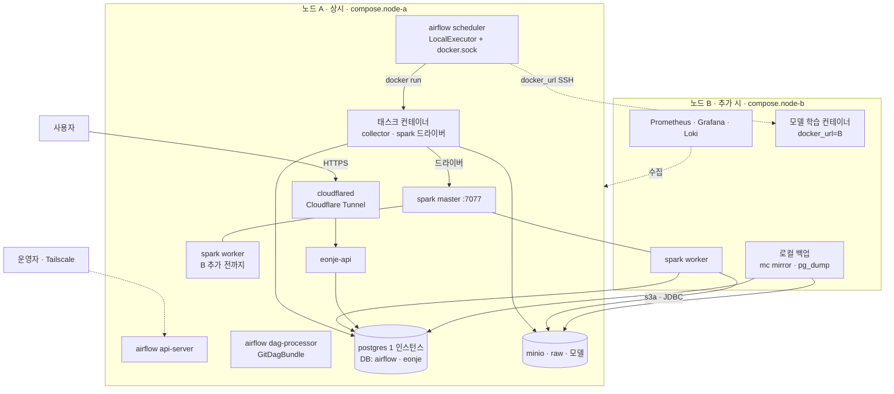

# 언제충전 (eonje) — 설계

EV 충전기 점유 패턴 서비스. 2026.10.09 시작.
서비스명 **언제충전**, 레포·패키지명 **`eonje`**. 요구사항은 [requirements.md](./requirements.md).
공개 API 기반 개인 프로젝트. 구현하면서 이 문서를 갱신한다.
2026.10.25 갱신: Spark 단일 엔진, 런타임별 이미지, 홈서버 노드 A/B, 서버에 코드를 두지 않는 CI/CD, GitDagBundle.

## 1. 서비스 정의

전국 전기차 충전기 상태를 계속 수집해, 공식 데이터가 주지 않는 **이력 기반 정보**를 제공한다.

- 사용자: 전기차 차주
- 핵심 기능 (우선순위 순)
  1. 충전소·충전기별 요일×시간대 점유 패턴 (언제 비는가)
  2. 장기 비정상 충전기 추적 (통신이상·운영중지·점검중이 며칠째 지속)
  3. 시설 유형·지역·운영기관별 점유 통계 (고속도로 휴게소 급속의 주말 오후, 아파트 완속의 야간 등)
  4. 예측 — 남은 충전 시간, 도착 시점 빈자리 확률 등. 처음엔 같은 요일·시간대 평균(베이스라인), 데이터가 쌓이면 모델 (10장, 요구사항 FR-40~49)
  5. (3단계) 요청 기반 빈자리 알림 — 이력·예측과 결합. 상세는 요구사항 FR-60~63
- 하지 않는 것: 지도 검색·결제·리뷰·상시 감시 알림. 기존 앱(EV Infra, 모두의충전, ChargEV 등)이 이미 함. 차별점은 이력.

## 2. 아키텍처

### 2.1 전체 구조



데이터는 한 방향으로만 흐른다: API → 원본 → 정제 → 집계 → 서빙. 역방향은 원본에서 재처리하는 경로 하나뿐이다.
수집은 순수 Python, **수집 이후의 모든 변환·집계는 Spark 단일 엔진**이다. 10분 증분과 백필이 같은 코드를 쓴다. DuckDB는 원본 탐색용이고 변환·서빙 경로에는 없다.

### 2.2 계층과 책임

| 계층 | 책임 | 하지 않는 것 |
|---|---|---|
| 수집 (ingest) | API 호출, 페이지 순회, 재시도, 호출 예산, 원본 저장. 순수 Python | 파싱·타입 변환·판단 |
| 원본 (raw) | 응답을 받은 그대로 보존. 전 컬럼 문자열. 재처리의 유일한 출발점 | 수정·삭제 |
| 정제 (transform) | 타입 변환, 중복 제거, 차원 SCD2, 전이 계산, 세션 복원, 보정. Spark | API 호출, 외부 I/O (Spark DataFrame in → DataFrame out) |
| 집계 (aggregate) | 요일×시간대 점유, 비정상 지속, 품질 지표. 증분. Spark | 원본 접근 |
| 예측 (ml) | 피처 생성(Spark), 학습(LightGBM 등), 배치 추론 → 예측 테이블 | 서빙 시점 추론 |
| 서빙 (serve) | 집계·예측 테이블 읽기 전용 API | 쓰기, 집계 계산 |
| 오케스트레이션 (Airflow) | 스케줄, 의존성, 재시도, 재실행 | 비즈니스 로직, 계산 분배 (Spark가 함) |

### 2.3 실행 모델 — 태스크는 런타임별 컨테이너에서

- **Airflow는 지휘만 한다.** 공식 이미지(DAG bundle용 git provider가 없으면 그것만 얹은 얇은 이미지). Airflow 이미지에 Spark·pandas·eonje 패키지를 넣지 않는다. DAG 파일은 `airflow`와 표준 라이브러리만 import
- **태스크 이미지는 런타임별로 나눈다.** Dockerfile은 `docker/` 아래 폴더 하나에 이미지 하나, 이미지 이름 = 폴더 이름

  | 이미지 | Dockerfile | 내용 | 쓰는 곳 |
  |---|---|---|---|
  | `eonje-collector` | `docker/tasks/collector/` | python:3.11-slim + uv + eonje (httpx, pyarrow, s3fs) | `check_budget`, `fetch_*` |
  | `eonje-spark` | `docker/tasks/spark/` | Spark + PySpark + eonje + s3a·JDBC jar | Spark 드라이버(태스크), master, worker 공용 — 명령만 다름. Spark·Python 버전이 자동으로 일치 |
  | `eonje-ml` | `docker/tasks/ml/` | eonje + LightGBM 등 | 학습·배치 추론 (9단계) |
  | `eonje-api` | `docker/api/` | eonje + FastAPI | 조회 API |

- 태스크는 `@task.docker(image="ghcr.io/jungyu333/eonje-<runtime>:<sha>", command=["python", "-m", "eonje.cli", "<job>", "--run-id", ...])`. 진입점은 모든 태스크 이미지에서 같다
- 태스크 간 데이터는 XCom이 아니라 MinIO·DB를 거친다. XCom은 run_id·건수·페이지 상한 같은 작은 값만
- 네트워크: 수집 태스크는 compose 네트워크에 붙어 Postgres·MinIO에 접근. Spark 드라이버 태스크는 `network_mode: host` (다른 노드의 executor가 드라이버에 접속해야 함, 8.2)
- 원격 실행: 모델 학습 등 Spark가 아닌 무거운 태스크는 `@task.docker(docker_url=<B>)`로 B 노드의 Docker에서 실행 (8.1)
- 효과: Airflow와 파이프라인 의존성 완전 분리. "`eonje`는 Airflow 없이 돈다"는 경계가 런타임에서 강제됨. 이미지가 런타임별이라 수집 이미지에 Spark가 없고, Spark 이미지 크기가 수집 배포를 느리게 하지 않는다
- 비용: scheduler에 `/var/run/docker.sock` 마운트(호스트 root 상당 권한 — 1인 홈서버에서 감수), 태스크당 컨테이너 기동 수 초(10분 주기엔 무시)

### 2.4 모듈 경계 — 레포 구조

```
eonje/
  eonje/                  # 순수 Python 패키지. Airflow를 import하지 않는다
    cli/                  # 태스크 진입점: `python -m eonje.cli <job> --run-id ...`
      __main__.py         # app.main 위임만
      app.py              # 인자 파싱, 설정 로드, job 디스패치, 종료 코드
      registry.py         # job 이름 → 함수 매핑
      jobs/               # job 하나 = 모듈 하나 = DAG 태스크 하나. client·storage·transform 배선만, 로직 없음
    config.py             # 설정값 (한도·간격·지역·페이지 크기·Spark master 등). EONJE_ 환경변수·.env에서 로드
    client/               # API 클라이언트: 요청 조립, 페이지네이션, 재시도, 응답 검증
    budget/               # 호출 예산: 오늘 사용량 조회, 실행 가능 여부·페이지 상한 판단
    storage/
      raw.py              # 원본 Parquet 경로 규칙, 쓰기(수집) — pyarrow + s3fs
      spark.py            # SparkSession 생성(설정 주입), s3a 읽기, JDBC 스테이징 쓰기
      models.py           # SQLAlchemy ORM 모델 (서비스 DB 스키마의 단일 출처. Alembic autogenerate 대상)
      db.py               # 엔진·세션, 스테이징 → INSERT ... ON CONFLICT 반영
    transform/            # 순수 함수. Spark DataFrame in → DataFrame out. I/O 없음
      dims.py             # SCD2 비교·갱신 행 생성
      observations.py     # 중복 제거, 타입 변환, 관측 시각 버킷
      transitions.py      # charger_state와 비교 → 전이 이벤트
      sessions.py         # last_ts/last_te/now_ts → 세션 upsert 행
      reconcile.py        # 전체 스냅샷 vs 추적 상태 불일치 → 보정 전이
      aggregate.py        # 점유·비정상·품질 지표
    codes/                # 코드표 (버전별 YAML) + 로더
  api/                    # FastAPI. 집계·예측 테이블 read-only. eonje.storage.models를 그대로 조회
  dags/                   # 얇은 DAG. @task.docker로 eonje.cli 호출만. Airflow가 GitDagBundle로 직접 가져감 (서버에 마운트 안 함)
    ev_master_daily.py
    ev_status_10min.py
    ev_aggregate_hourly.py
  docker/
    tasks/collector/Dockerfile
    tasks/spark/Dockerfile
    tasks/ml/Dockerfile   # 9단계
    api/Dockerfile
  web/                    # 프론트 (후순위)
  docs/                   # 이 문서들
  infra/
    compose.node-a.yaml   # 상시 노드: airflow, postgres, minio, spark master·worker, eonje-api, cloudflared. 개발 PC도 이것을 사용
    compose.node-b.yaml   # 보조 노드: spark worker, 모니터링, 로컬 백업 (B 추가 시)
    postgres/init.sql     # 첫 기동 시 airflow·eonje DB와 역할 생성 (compose configs로 주입)
    migrations/           # Alembic — models.py에서 autogenerate, 검토 후 커밋
    .env.example
  tests/
    unit/                 # transform·budget·client·cli 단위 테스트 (Airflow·네트워크 없이). Spark 변환은 로컬 SparkSession
    fixtures/             # 실제 API 응답 샘플 (키 제거)
  .github/workflows/
    ci.yml                # ruff, mypy, pytest, 이미지 빌드 (PR)
    cd.yml                # GHCR 푸시 + 노드 배포 + deploy ref 이동 (main)
```

경계 규칙:
- **Airflow를 아는 코드는 `dags/`뿐.** `eonje`는 Airflow 없이 import·테스트되고, 런타임에서도 별도 컨테이너라 Airflow 패키지가 아예 없다. CLI로 백필할 때도 같은 진입점.
- **외부 I/O를 아는 코드는 `client/`와 `storage/`뿐.** SparkSession 생성, s3a 읽기, JDBC 쓰기도 `storage/`에 둔다. `transform/`은 DataFrame만 받는 순수 함수라 로컬 SparkSession과 fixture로 테스트한다.
- **API 어휘(`statId`, `chgerId`, `stat`…)는 `observations.py`에서 내부 어휘(`stat_id`, `charger_id`, `status_code`)로 한 번 번역**하고, 그 아래로는 내부 어휘만 쓴다. 응답 필드가 바뀌어도 수정 지점은 한 곳.
- 설정값은 `config.py`에서만 읽는다. DAG 스케줄 간격도 거기서 가져온다 (DAG 파일은 환경변수를 직접 읽음 — eonje import 불가).
- **`__init__.py`에는 로직을 두지 않는다.** 전부 빈 파일. re-export도 하지 않아 import는 항상 모듈까지 적는다 (`from eonje.cli.app import main`). `__main__.py`는 위임 두 줄만.
- **DB 스키마의 단일 출처는 `models.py`.** 파이프라인 적재와 API 조회가 같은 모델을 쓴다. 대량 적재는 Spark → JDBC 스테이징 테이블 → `INSERT ... ON CONFLICT`. 행 단위 `session.add`는 금지.
- **Spark 규칙 (처음부터 지킨다):** 데이터는 `s3a://`(MinIO)와 JDBC로만 읽고 쓴다 — 로컬 경로 금지(다른 노드의 executor가 못 읽음). jar·패키지는 전부 이미지에 넣는다. 큰 데이터에 `collect()`·`toPandas()` 금지. `spark.sql.session.timeZone=Asia/Seoul`을 명시한다.

### 2.5 런타임 토폴로지



- **원칙: 상태를 가진 것(Postgres·MinIO)과 수집 경로·Airflow는 A에만 둔다.** B가 꺼져도 A의 수집은 계속되고, B는 A를 계산·감시·보관하는 보조 노드다. 서비스 배치는 고정 (8.1)
- **공유기 포트는 열지 않는다.** 공개 트래픽은 Cloudflare Tunnel(나가는 연결)로 `eonje-api`에만, 관리 접근(SSH·Airflow·Spark·MinIO 콘솔·Grafana)은 Tailscale로만
- 로컬 개발 PC는 `compose.node-a.yaml`을 그대로 쓰고 Spark는 `local[*]`. 차이는 `.env`뿐
- **Postgres는 인스턴스 하나, 데이터베이스 둘**(`airflow`, `eonje`)에 역할도 둘. `init.sql`로 첫 기동 시 생성. Airflow 메타DB를 초기화·교체해도 `eonje` DB는 무관하고, 백업은 DB 단위 `pg_dump`
- 원본 저장소는 MinIO(S3 호환). `storage/`는 s3fs(수집)·s3a(Spark)로 다루므로 외부 객체 스토리지로 옮겨도 엔드포인트만 교체

### 2.6 처리 흐름 요약

```
[10분마다]  예산 확인 → period=10 전 페이지 수집 → raw 저장
            → 중복 제거·버킷 → obs_status
            → charger_state와 비교 → evt_transition, charger_state 갱신
            → last_ts/last_te/now_ts → fact_session upsert

[1일 1회]   53페이지 수집 → raw 저장
            → dim_station·dim_charger SCD2
            → 전체 stat vs charger_state → 보정 전이 (source=reconciled)
            → obs_status (source=full)

[매시]      obs·session 증분 → agg_occupancy_hourly, agg_station_hourly
            → agg_abnormal, 품질 지표
```

역할: 10분 수집은 **움직임**(변경분), 일 1회 수집은 **전체 모습과 정답지**(마스터 + 보정), 매시 집계는 **사용자용 요약**. 집계는 API 호출 없음.
정제·전이·세션·집계는 Spark 태스크이고, 미처리 원본 run을 전부 처리하는 워터마크 방식이라 변환이 멈췄다 살아나도 따라잡는다 (7장).

## 3. 기술 스택

선택 기준: 1인 운영 가능, 개발 PC와 운영 노드가 같은 구성, 바꿀 때 한 곳만 바꾸면 될 것.

| 영역 | 선택 | 이유·비고 |
|---|---|---|
| 언어 | Python 3.11 (파이프라인·API), TypeScript (프론트) | |
| 패키지 관리 | uv (`pyproject.toml`, lock) | 설치 빠름. 모든 이미지 빌드에 사용 |
| 오케스트레이션 | Apache Airflow 3.x 공식 이미지, LocalExecutor, TaskFlow `@task.docker` | Airflow는 지휘만. 계산 분배는 Spark |
| DAG 배포 | Airflow 3 DAG bundle (`GitDagBundle`) | Git `deploy` ref를 추적. run마다 DAG 버전 기록. 서버에 DAG 파일을 두지 않음 (8.3) |
| 태스크 실행 | Docker provider (`@task.docker`), 런타임별 이미지 | 기본은 A의 Docker, 학습 등은 `docker_url`로 B |
| HTTP 클라이언트 | httpx + tenacity | 동기로 충분(페이지 순차). 재시도·백오프는 tenacity |
| 설정 | pydantic-settings | `EONJE_` 환경변수 → 타입 검증된 설정 객체. `config.py` 하나 |
| 수집 저장 | pyarrow + s3fs | 수집은 Spark 없이 Parquet 쓰기만 |
| 변환·집계 | **Apache Spark (PySpark), standalone 클러스터, client 모드** | 단일 엔진. 10분 증분과 백필이 같은 코드. 노드 추가 시 worker만 붙임 (8.2) |
| 원본 저장 | Parquet, MinIO (S3 호환) | 수집은 s3fs, Spark는 s3a |
| 서비스 DB | PostgreSQL 16 (1 인스턴스, `airflow`·`eonje` 2 DB), SQLAlchemy 2 ORM (Declarative, `Mapped[]`), psycopg 3, Alembic | 모델이 스키마·마이그레이션·API 조회의 단일 출처. 적재는 Spark JDBC 스테이징 → `INSERT ... ON CONFLICT` |
| 예측 | LightGBM, 생존분석 등 표 데이터 모델 | 주 1회 학습(B), 매시 배치 추론 → 예측 테이블. 서빙은 테이블 조회만 (10장) |
| 자연어 요약 | 외부 LLM API | 자체 호스팅 안 함. 생성한 문장만 저장 |
| 분석 | Jupyter + DuckDB | 원본 Parquet 탐색·검증. 변환·서빙 경로에는 안 씀 |
| API | FastAPI, pydantic v2, uvicorn | `/v1/` 버전 고정. 응답 스키마 = 프론트·모바일 공통 계약 |
| 프론트 | React + TypeScript + Vite | 정적 SPA. API만 호출, 로직 없음. 배포 방식은 미결(12장) |
| 지도 | Kakao Maps JS SDK | 국내 지도 품질·무료 쿼터. 모바일은 네이티브 SDK로 교체, 데이터는 동일 |
| 차트 | Apache ECharts | 히트맵 내장. 7×24 격자 |
| 공개·TLS | Cloudflare Tunnel + Cloudflare DNS (무료 플랜) | 포트포워딩·고정 IP·인증서 관리 없음. 집 IP 비노출, 기본 DDoS 방어 |
| 관리 접근 | Tailscale | SSH, Airflow·Spark·MinIO·Grafana UI. CD 러너도 tailnet으로 접속 |
| 컨테이너 | Docker, docker compose (노드별 파일) | 개발 PC = 노드 A 구성 |
| 이미지 레지스트리 | GHCR (`ghcr.io/jungyu333/eonje-*:<git-sha>`) | Actions `GITHUB_TOKEN`으로 푸시. 공개 이미지라 서버 pull에 인증 불필요 |
| 운영 노드 | 집 미니PC (A 상시, B는 부족 신호 시 추가) | 8.1 |
| 테스트 | pytest, 실제 응답 fixture, 로컬 SparkSession | `transform/`은 fixture로 커버. DB 테스트는 `db` 마커 + Actions `services:` Postgres |
| 품질 | ruff (lint·format), mypy strict, pre-commit | pre-commit 훅: ruff(프로젝트 venv 버전), ruff-format, EOF·공백·YAML·TOML 검사, 대용량 파일·개인키 차단. mypy는 CI |
| CI | GitHub Actions | PR: ruff + mypy + pytest + 이미지 빌드(푸시 없음) |
| CD | GitHub Actions + Tailscale + SSH | main: 이미지 GHCR 푸시 → 노드에 compose 배포 → 헬스체크 → `deploy` ref 이동 (8.3) |
| 알림·관측 | A 단독: 텔레그램 봇. B 추가 후: Prometheus + Grafana + Loki (B에서 실행) | A가 죽어도 B에서 알림 발송 |
| 백업 | 로컬: B로 `mc mirror`·`pg_dump`. 오프사이트: R2 또는 B2 | 8.5 |
| 시크릿 | 노드의 `.env`(서버에서 직접 관리), GitHub Secrets(배포 SSH 키, Tailscale OAuth) | 레포에는 `.env.example`만 |

보류한 것: Kubernetes·k3s(compose로 시작, B 추가 시 재검토 — 8.6), Celery/Redis(LocalExecutor로 충분), dbt(변환이 Spark 코드로 충분), Kafka 등 스트리밍(10분 배치면 됨), async SQLAlchemy(읽기 전용 API에 이득 적음), pandas·DuckDB 변환 경로(Spark 단일 엔진으로 통일), 포트포워딩 + certbot(Cloudflare Tunnel로 대체), self-hosted Actions runner(public 레포에서 fork PR 코드가 서버에서 돌 위험), LLM 자체 호스팅, Postgres 인스턴스 분리(DB 분리로 충분).

## 4. 데이터 소스

한국환경공단 "전기자동차 충전소 정보" OpenAPI (공공데이터포털, 서비스 `B552584/EvCharger`). 활용가이드 v1.25 (2026.07.01). 개발계정 **일 1,000회**.

Base: `https://apis.data.go.kr/B552584/EvCharger/`

| 오퍼레이션 | 용도 | 주요 파라미터 | 응답 |
|---|---|---|---|
| `getChargerInfo` | 충전기 마스터 + 현재 상태 | `zcode`, `zscode`, `kind`, `kindDetail`, `statId`, `chgerId` | 40여 필드 |
| `getChargerStatus` | 상태만 (경량) | `period`(분, 1~10, 기본 5) + 위 필터 | `busiId statId chgerId stat statUpdDt lastTsdt lastTedt nowTsdt` |

공통: `serviceKey`, `pageNo`, `numOfRows`(10~9,999), `dataType=JSON`. 응답 `resultCode`, `totalCount`, `items.item[]`.

### 실측 (2026.10.09 금 14:00~14:20 KST)

| 호출 | totalCount | 비고 |
|---|---|---|
| `getChargerInfo` 전체 | **526,239** | 9,999건씩 53페이지 |
| `getChargerInfo zcode=11` (서울) | **76,005** | 14.5%, 8페이지 |
| `getChargerStatus period=10` | **13,668** | 전국의 2.6%, 2페이지 |
| `getChargerStatus period=1` | **0** | 비정상. 상류 배치 반영 지연 또는 하한 미준수로 추정. 짧은 period 사용 안 함 |

### 필드에서 확인된 사실

- `statUpdDt`는 운영기관마다 의미가 다르다. 환경부(ME) 충전기는 상태 변화 없이도 15분쯤마다 갱신됨(주기 보고). 전체 2.6%만 10분 내 갱신이므로 다른 기관은 변경 시만 올리는 것으로 보임. → **전이 시각으로 쓰지 않는다.** 관측으로 저장하고 전이는 직전 상태와 비교해 계산.
- 실제 전이도 잡힌다: `stat=3`이 되며 `nowTsdt`와 `statUpdDt`가 1초 차이로 기록됨.
- `lastTsdt`/`lastTedt`(마지막 충전 시작·종료)가 충실히 채워짐. 전이를 놓쳐도 충전기별 마지막 세션은 복원 가능. 50kW 급속 세션은 대략 20~40분.
- `nowTsdt`는 충전 중일 때만 값이 있음.
- `statId`는 숫자 8자리가 아니라 `ME174013`처럼 기관 코드 접두 문자열.
- `maker`(제조사) 필드가 문서에 없는데 옴. `powerType`은 빈 값. → 원본은 가공 없이 저장.
- 상태 코드가 문서 두 곳에서 다름. 필드 설명: 0 알수없음 / 1 통신이상 / 2 사용가능 / 3 충전중 / 4 운영중지 / 5 점검중. 공통코드표: 2 충전대기, 6 예약중, 9 상태미확인 추가. → enum 고정 금지. 미지 코드도 저장, 집계 시 매핑.
- 요청 명세에 `statId`·`chgerId`가 필수로 표기돼 있으나 없어도 호출됨 (표기 오류).
- 정렬이 기관·등록 순이라 한 페이지로 분포 추정 불가.
- 지역 코드가 2026년에도 계속 변경됨(v1.25, "12 전남광주통합특별시"). 코드표는 버전 관리되는 참조 데이터로.
- 키: 브라우저는 Encoding 키, `requests params=`는 Decoding 키.

### 차원으로 쓸 수 있는 마스터 필드

`kind`/`kindDetail`(시설 유형 10/70여 종), `zcode`/`zscode`(시도/시군구), `busiId`(운영기관 140여), `chgerType`(11종, NACS 포함), `output`(kW), `method`(단독/동시), `limitYn`/`limitDetail`, `parkingFree`, `useTime`, `year`(설치년도), `floorType`/`floorNum`, `delYn`/`delDetail`(철거 이력), `maker`.

## 5. 수집 전략

호출 한도가 설계를 결정한다. 한도·간격·지역은 전부 설정값이고, 운영계정 전환 시 설정만 바꾼다.

| 수집 | 주기 | 호출/일 | 내용 |
|---|---|---|---|
| 마스터 전체 | 1일 1회 | 53 | `getChargerInfo` 전 페이지. 차원 갱신 + 그날의 전체 상태 기준점 |
| 상태 변경분 | 10분 | 144 × 2~3 = 288~432 | `getChargerStatus period=10 numOfRows=9999` 전 페이지 |
| 여유 | | ~500 | 재시도, 수동 조회, (3단계) 알림용 집중 폴링 |

- 초기값 10분 간격. 며칠 `totalCount` 분포(특히 저녁 피크)를 쌓은 뒤 간격 조정. 5분 간격은 최대 917회로 한도에 붙어 보류.
- `period=10`에 10분 간격이면 겹침이 없다. 호출 실패 시 그 10분의 전이는 잃지만 `lastTsdt`/`lastTedt`로 세션은 다음 관측에서 복원됨. 겹침(5분 간격)으로 가면 `(statId, chgerId, statUpdDt)` 중복 제거 필수 — 지금부터 넣어 둔다.
- **예산 관리자**: 호출마다 `api_call_log`에 기록. 상태 DAG는 실행 시 오늘 사용량을 읽어 남은 예산이 하루 잔여 실행 횟수 × 예상 페이지 수에 못 미치면 건너뛰거나 페이지 수를 제한한다. 마스터 DAG는 상태 DAG보다 우선.
- 페이지 사이 상태 변화: 한 수집 안에서 페이지가 다른 시각에 조회되므로, 관측 시각은 페이지 응답 시각이 아니라 **수집 시작 시각(버킷)**으로 통일. 원본에는 페이지 응답 시각도 남김.
- 스냅샷 보정: 마스터 전체 조회의 `stat`를 기준점으로 삼아, 변경분으로 추적 중인 상태와 불일치하는 충전기를 찾아 보정 이벤트를 만든다 (놓친 전이의 사후 기록). 불일치 비율을 지표로 남긴다.

## 6. 데이터 모델

### 원본 (Parquet, MinIO, run 단위)

경로 (`storage/raw_paths.py`). 버킷은 `EONJE_RAW_BUCKET`, 접속은 `EONJE_S3_ENDPOINT_URL`·`EONJE_S3_ACCESS_KEY`·`EONJE_S3_SECRET_KEY`. 경로에는 스킴이 없고, 수집기(s3fs)는 그대로, Spark는 `s3a://`를 붙여 쓴다.

```
{bucket}/charger_status/dt=YYYY-MM-DD/run=<run_key>/page=NNN.parquet
{bucket}/charger_status/dt=YYYY-MM-DD/run=<run_key>/_manifest.json
{bucket}/charger_info/...   (같은 구조)
```

- **`dt`는 수집 시각(`collected_at`)의 KST 날짜**(`partition_date`). 기록기가 `run.dt`와 맞지 않으면 거부한다 → 같은 run이 두 날짜 파티션에 생기지 않는다
- `run_key`는 경로에 안전한 문자만(`[0-9A-Za-z_.-]`). Airflow run_id에서 결정적으로 만든다 (#8)
- 컬럼: 응답 item의 필드 전부를 **string**으로 받은 그대로(미지 필드 유지, 문자열이 아닌 JSON 값은 JSON 표기 그대로) + 메타 `collected_at`(timestamp UTC), `page_fetched_at`(timestamp UTC), `page_no`(int32). 타입 변환은 정제 단계에서
- 스키마는 페이지에 나온 필드로 정해져 페이지·run마다 컬럼 구성이 다를 수 있다. Spark는 `mergeSchema`로 읽는다 (전부 string이라 타입 충돌 없음)
- 시각은 모두 시간대가 있어야 하고 UTC로 저장한다. 시간대 없는 시각은 거부

쓰기 규칙 (`storage/raw.py`, `storage/raw_run.py`):
- 페이지는 메모리 버퍼에 Parquet(zstd)으로 다 쓴 뒤 한 번에 올린다 → 실패하면 객체가 생기지 않는다
- run은 `start → write × N → finish`. `start`는 **manifest를 먼저 지우고** run 폴더를 비운다(재실행 때 지난 페이지가 남지 않음). `finish`는 모든 페이지를 쓴 뒤 **`_manifest.json`을 마지막에** 쓴다
- **manifest가 있는 run만 완료된 run이다.** 읽는 쪽(Spark 워터마크)은 manifest가 없는 run을 건너뛴다. 중간 실패·정리 실패 모두 manifest가 없는 상태로 남는다
- manifest: `version, dataset, operation, dt, run_key, collected_at(UTC), total_count(1페이지 값), row_count, pages`. 완료 시각처럼 재실행마다 바뀌는 값은 넣지 않아 같은 run이면 내용이 같다. `row_count < total_count`면 예산 상한으로 잘린 run
- 원본은 run 단위로 덮어쓸 수 있지만, 한 번 완료된 run의 내용은 같은 입력이면 같다 (멱등)

### 서빙·정제 (Postgres `eonje` DB, `storage/models.py`)

| 테이블 | 키 | 내용 |
|---|---|---|
| `dim_station` | `stat_id` | 충전소. 이름·주소·좌표·시설 유형·지역·운영기관·이용시간·주차료·이용제한. SCD2 (`valid_from`, `valid_to`) |
| `dim_charger` | `stat_id, chger_id` | 충전기. 타입·출력·방식·제조사·설치년도·층·삭제 여부. SCD2 |
| `obs_status` | `stat_id, chger_id, observed_at` | 관측 1행. `stat`, `stat_upd_dt`, `last_ts`, `last_te`, `now_ts`, `source`(delta/full) |
| `evt_transition` | `stat_id, chger_id, at` | 상태 전이. `from_stat`, `to_stat`, `at`(전이 추정 시각), `detected_at`, `source`(observed/reconciled) |
| `fact_session` | `stat_id, chger_id, started_at` | 충전 세션. `ended_at`, `duration_min`, `source`(last_ts/now_ts). `lastTsdt`/`lastTedt` 쌍이 새로 보일 때 upsert |
| `charger_state` | `stat_id, chger_id` | 충전기별 마지막으로 알려진 상태 (전이 계산용 현재 상태) |
| `agg_occupancy_hourly` | `stat_id, chger_id, dow, hour` | 점유율(충전중 비율), 관측 수, 세션 수, 평균 세션 길이 |
| `agg_station_hourly` | `stat_id, dow, hour` | 충전소 단위 (충전기 합산) |
| `agg_abnormal` | `stat_id, chger_id` | 비정상 상태(1·4·5·9) 시작 시각, 지속 일수 |
| `api_call_log` | `called_at` | 오퍼레이션, 파라미터, `total_count`, 페이지, 응답 시간, 결과 코드 |
| `ml_model` | `name, version` | 모델 파일 경로(MinIO), 학습 구간, 정확도, 운영 버전 여부 (9단계) |
| `pred_*` | 대상별 | 매시 배치 추론 결과. API는 이 테이블만 읽음 (9단계) |
| `ref_code_*` | 코드, 버전 | 상태·충전기타입·지역·시설·기관 코드표 |

관측과 세션은 전국 기준으로 쌓고, 집계와 서빙은 설정된 지역(처음엔 서울)만. 나중에 전국으로 열 때 백필 가능.

## 7. DAG 구성

Airflow 3, LocalExecutor, TaskFlow `@task.docker`. 각 태스크 = 컨테이너 1개 = `python -m eonje.cli <job> --run-id <run_id>`. 이미지는 태스크의 런타임으로 정한다 (C = `eonje-collector`, S = `eonje-spark`). 모든 태스크는 **파티션 키(run_id) 기준 멱등** — 같은 구간을 다시 돌리면 결과가 같다.

Spark 태스크는 pool `spark`(A 단독일 때 슬롯 1)로 한 번에 하나만 돈다. 변환은 **워터마크** 방식이다: 자기 run의 원본만이 아니라 아직 처리하지 않은 원본 run을 전부 처리한다. 그래서 변환이 멈췄다 살아나면 자동으로 따라잡고, 수집은 변환 상태와 무관하게 계속된다.

### `ev_master_daily` (1일 1회)
1. `fetch_pages` (C) — 53페이지 순회, 원본 저장. 페이지 단위 재시도. 호출 로그 기록
2. `load_dims` (S) — SCD2 갱신 (변경된 행만 새 버전)
3. `reconcile_state` (S) — 전체 `stat`를 `charger_state`와 비교, 불일치는 보정 전이 생성
4. `load_obs` (S) — 전체 상태를 `obs_status`에 `source=full`로 적재
5. `refresh_codes` (C) — 응답에서 본 미지 코드 보고

### `ev_status_10min` (10분)
1. `check_budget` (C) — 오늘 사용량 조회, 실행 여부·페이지 상한 결정 (XCom으로 상한 전달)
2. `fetch_delta` (C) — `period=10` 전 페이지, 원본 저장
3. `dedupe_load_obs` (S) — 중복 제거 후 `obs_status` 적재 (`source=delta`)
4. `derive_transitions` (S) — `charger_state`와 비교해 `evt_transition` 생성, `charger_state` 갱신
5. `upsert_sessions` (S) — `last_ts`/`last_te`/`now_ts`로 `fact_session` upsert

3~5는 한 Spark 앱(드라이버 컨테이너 하나)으로 묶을 수 있다. 묶을지는 소요 시간을 재 보고 정한다.

### `ev_aggregate_hourly` (매시)
1. `agg_occupancy` (S) — 지난 구간의 관측·세션에서 증분 집계
2. `agg_abnormal` (S) — 비정상 지속 목록 갱신
3. `quality_metrics` (S) — 결측 구간, 불일치 비율, 미지 코드 수

### 예측 (9단계, 10장)
- `ml_train_weekly` — 피처 생성(S) → 학습(`eonje-ml`, `docker_url`=B) → 모델 파일 MinIO 저장, 운영 버전 Postgres 기록
- `ml_infer_hourly` — 운영 버전 모델로 배치 추론 → 예측 테이블

재실행 규칙: 원본은 `run=<ts>` 디렉터리 덮어쓰기. `obs_status`는 키 충돌 시 무시. 전이·세션은 upsert. 집계는 구간 단위 삭제 후 재계산. 백필은 Airflow 없이 `eonje.cli`를 직접 호출해도 같은 결과.

## 8. 인프라·운영

### 8.1 노드

미니PC 한 대(A)로 시작하고, 부족 신호가 보이면 한 대(B)를 추가한다. 서비스 배치는 고정이고, 노드 추가는 Spark worker를 붙이고 보조 역할을 옮기는 것뿐이다.

| 노드 | 역할 | 올라가는 것 |
|---|---|---|
| A (상시) | 수집·저장·지휘·서빙 | Airflow, Postgres, MinIO, 수집 태스크, eonje-api, cloudflared, **Spark master(고정)**, Spark worker(B 전까지), Spark 드라이버(job마다 뜨는 태스크 컨테이너) |
| B (추가 시) | 계산·감시·보관 | **Spark worker**, **모니터링**(Prometheus·Grafana·Loki·알림), **로컬 백업**(MinIO 미러, `pg_dump`), **모델 학습**(Spark가 아닌 무거운 태스크) |

노드 A 사양: AMD Ryzen 3 4300U (Zen 2, 4코어 4스레드), LPDDR4 16GB(온보드, 증설 불가), M.2 SSD 512GB, 유선 1GbE. Ubuntu Server 26.04 LTS, Docker(로그 로테이션 10m×3), 스왑 8GB(swappiness 10), SSH 키 로그인만, 공유기 DHCP 예약으로 고정 내부 IP. B는 필요해지는 시점의 가격으로 고른다 (로컬 백업을 받으니 SSD 512GB 이상).

메모리 배분 (16GB):
- A (B 전): OS·Docker 1~1.5, Airflow 2~2.5, Postgres 1.5~2, MinIO·API·cloudflared ~1, collector ~0.3, Spark master 0.5 + worker 데몬 0.7 + executor 3~4 + 드라이버 1 → 피크 12.5~14GB. 메모리는 증설할 수 없으므로 부족하면 B 추가로 해결
- B: OS·Docker 1, 모니터링 1.5~2, worker 데몬 ~1, 나머지를 executor에. 모델 학습은 Spark 큰 배치와 시간대를 겹치지 않게 스케줄

**B 추가 신호** (처음부터 Spark 태스크 소요 시간·메모리를 기록한다): 10분 변환 소요 시간이 계속 늘어 주기를 위협, Spark pool 대기가 잦음, A의 메모리·스왑 사용이 상시 높음. 구현 단계가 아니라 측정으로 결정한다.

### 8.2 Spark 실행

- **운영은 처음부터 standalone 클러스터, client 모드.** PySpark는 standalone에서 cluster 모드를 지원하지 않는다. 개발 PC는 `local[*]`
- 역할: master = 클러스터 자원 관리자(상시, 하나). 드라이버 = 앱 하나의 지휘자(job마다 생성·소멸, 우리 태스크 컨테이너). worker = executor를 띄우는 노드 데몬. executor = 앱에 배정된 계산 프로세스, 드라이버와 직접 통신
- master는 A에 고정. `EONJE_SPARK_MASTER=spark://<A>:7077`은 노드가 늘어도 바뀌지 않는다
- master·worker·드라이버 모두 `network_mode: host`, `spark.driver.host` = A의 랜 IP. 앱마다 `spark.cores.max`·`spark.executor.memory`로 자원을 나눈다
- A 단독일 때: worker 코어 2~3·메모리 4GB 정도, Spark 앱은 pool 슬롯 1. Spark master UI 포트는 8080에서 바꾼다(Airflow api-server와 충돌), worker UI 포트도 조정
- B 추가 시: B에 worker를 `spark://<A>:7077`로 붙인다. A의 `.env`·DAG·코드는 바뀌지 않는다. 이후 A의 worker를 줄이거나 내린다(미결)
- 노드 간 통신 (B 추가 후): B → A는 MinIO 9000, Postgres 5432, Spark master 7077, 모니터링 수집 대상. A → B는 Docker 데몬(학습 태스크, SSH 방식 권장), 드라이버 ↔ executor 포트. 전부 집 내부망·Tailscale에서만, 필요하면 `spark.authenticate`

### 8.3 배포 (CI/CD)

**서버에 코드를 두지 않는다.** 노드에는 실행 명세와 비밀값, 데이터만 있다.

```
~/eonje/
  compose.yaml   # CD가 배포 때마다 덮어씀
  .env           # 서비스 키·비밀번호. 서버에서 직접 관리
+ docker 볼륨     # Postgres·MinIO 데이터
```

- 코드는 이미지에, DAG는 Git에, 설정 파일(`init.sql` 등)은 compose `configs:`에 넣는다
- **CI** (PR): ruff, mypy, pytest, 이미지 빌드(푸시 없음)
- **CD** (main 머지):
  1. 이미지 빌드 → GHCR에 `<git-sha>` 태그로 푸시
  2. deploy 잡이 Tailscale에 임시 노드(`tag:ci`)로 접속. ACL로 노드의 SSH 포트에만 허용
  3. `scp`로 compose 파일 복사 → `ssh <노드> "EONJE_IMAGE_TAG=<sha> docker compose pull && docker compose up -d"`
  4. 헬스체크 (API `/health`, Airflow 상태)
  5. Git의 `deploy` ref를 `<sha>`로 이동 → Airflow가 새 DAG를 가져감
- **DAG 배포는 GitDagBundle**(`tracking_ref=deploy`, `subdir=dags`). `main`을 추적하지 않는 이유: 머지 직후 이미지가 아직 없을 때 새 DAG가 새 job을 부르면 실패한다. CD가 이미지 푸시 후 ref를 옮겨 순서를 보장한다. DAG만 바뀌면 ref만 옮기면 된다
- 배포 전용 SSH 키와 Tailscale OAuth 클라이언트는 GitHub Secrets. 필요하면 GitHub Environment `production`으로 수동 승인
- 롤백: `workflow_dispatch`로 이전 sha를 다시 배포
- self-hosted runner는 쓰지 않는다 (public 레포)
- 단계: CI는 골격 직후 PR, CD는 수집기 배포(2단계) PR

### 8.4 공개와 접근

- 공유기 포트포워딩 없음. 외부에서 들어오는 포트는 0개
- 공개: Cloudflare Tunnel. `cloudflared`가 Cloudflare로 나가는 연결을 열어 두고, 요청은 그 터널로 `eonje-api`에 전달. DNS·HTTPS·기본 DDoS 방어·정적 캐시는 Cloudflare(무료 플랜). 도메인은 서비스 공개(7단계) 때 구입
- 관리: Tailscale. SSH, Airflow·Spark·MinIO 콘솔·Grafana는 tailnet 안에서만. 서버 노드는 키 만료를 끈다
- SSH: 키 로그인만 (비밀번호·root 로그인 차단)

### 8.5 백업·모니터링·복구

- 원본은 가공 없이 영구 보존. 어떤 정제 결과도 원본에서 재생성 가능
- 로컬 백업 (B): A의 MinIO를 B로 `mc mirror`, `pg_dump`를 B에 일 단위 저장 — 빠른 복구용
- 오프사이트 백업: 원본 Parquet·`pg_dump`를 R2 또는 B2로 — 재해 대비. 노드가 A 하나뿐인 동안에도 오프사이트는 처음부터
- 복구 절차를 문서화하고 한 번은 실제로 연습한다
- 모니터링 (B): Prometheus(A·B 노드, Postgres·Airflow·Spark 지표) + Grafana + Loki(컨테이너 로그). 수집 중단·한도 근접·결측·디스크·메모리 알림을 B에서 발송 → A가 죽어도 알림이 나간다. B 전에는 텔레그램 알림만
- 홈서버 운영: UPS, BIOS 정전 후 자동 켜짐, 보안 업데이트 자동 설치

### 8.6 Kubernetes를 쓰지 않는 이유

compose로 시작하고 B 추가 시 k3s를 다시 검토한다 (2026.10.22 결정).
- 서비스 배치가 고정이고 계산 분배는 Spark standalone이 하므로 노드별 compose로 충분하다
- 처음부터 k3s는 메모리(A 16GB 고정), 인프라 선행 시간, Spark 설계 변경(standalone → spark-operator) 비용이 크다
- 검토 조건: 노드 간 서비스 이동·자동 failover(공유 스토리지 전제), 노드 셋 이상, PySpark cluster 모드, k8s 운영 경험 자체가 목표가 될 때. 옮기면 k3s + spark-operator
- 지금 구조(코드는 이미지, 설정은 선언 파일, DAG는 Git, 서버에는 compose와 `.env`만)는 k3s로 옮겨도 그대로 이어진다 — compose가 매니페스트로, `.env`가 Secret·ConfigMap으로

### 8.7 용량과 설정

- 용량 추정: 변경분 10분당 ~14k행 × 144 ≈ 200만 행/일(관측). Parquet 압축 시 수십 MB/일. Postgres `obs_status`는 월 단위 파티셔닝, 오래된 관측은 Parquet만 보존
- 설정값 (`EONJE_` 접두 환경변수, `config.py`): `EONJE_API_DAILY_LIMIT=1000`, `EONJE_STATUS_INTERVAL_MIN=10`, `EONJE_STATUS_PERIOD_MIN=10`, `EONJE_SERVE_ZCODES=["11"]`, `EONJE_PAGE_SIZE=9999`, `EONJE_SPARK_MASTER`, `EONJE_IMAGE_TAG`
- 시크릿: 서비스 키는 노드 `.env` → 태스크 컨테이너 환경변수로 주입. 레포에 넣지 않음

## 9. 서빙 (초안)

FastAPI. 집계·예측 테이블만 읽는다. `/v1/` 접두. 충전소 상세는 호출 1회로 상세 화면 전체(요구사항 FR-04~09)를 받는다.

- `GET /v1/stations?zscode=&kind=&bbox=` — 충전소 목록 + 현재 시간대 점유율
- `GET /v1/stations/{stat_id}` — 상세 화면 전체: 기본 정보, 요약 지표, 히트맵, 비는 시간대, 충전기 목록
- `GET /v1/stations/{stat_id}/chargers/{chger_id}` — 충전기 단위 패턴 (펼침용)
- `GET /v1/abnormal?zscode=&min_days=` — 장기 비정상 충전기
- `GET /v1/stats?by=kind|zscode|busi&dow=&hour=` — 단면 통계

프론트는 지도 + 히트맵. 나중에.

## 10. 예측 (ML)

데이터가 쌓인 뒤(9단계) 시작한다. 1차는 같은 요일·시간대의 최근 N주 평균(베이스라인, FR-40)이고, 모델은 베이스라인보다 정확도가 나을 때만 교체한다(FR-41).

- 대상: 남은 충전 시간(최우선, `nowTsdt`로 진행 중 세션의 경과 시간을 안다), 도착 시점 빈자리 확률, 출발 시점 추천, 혼잡 예보 등 (요구사항 FR-40~49)
- 모델: 표 데이터 모델 — LightGBM, 생존분석(세션 종료 시점). 피처는 요일·시간대·충전기 타입·출력·시설 유형·최근 점유·진행 중 세션 경과 시간 등
- 학습: 주 1회. 피처는 Spark(MinIO·Postgres)로 만들고, 학습은 `eonje-ml` 이미지로 B에서 (`docker_url`). 모델 파일은 MinIO에 버전을 붙여 저장하고, 운영 버전은 Postgres에 기록
- 추론: 매시 배치 추론 → 예측 테이블. API는 테이블만 읽는다 (요청 시점 추론 없음)
- 정확도: 주 단위로 실측과 비교해 기록·공개
- 자연어 요약: 외부 LLM API로 문장만 생성해 저장. 자체 호스팅 안 함

## 11. 구현 순서 (우선순위)

| 단계 | 내용 | 엔진 | 노드 |
|---|---|---|---|
| 1 | 레포 골격 (패키지, cli, config, Makefile, pre-commit) → 이미지·CI (`docker/tasks/collector`, ci.yml, `.env.example`) | — | 개발 PC |
| 2 | 수집기 배포: `check_budget`·`fetch_delta` + CD(GHCR, Tailscale 배포, GitDagBundle). **A에서 돌리기 시작** (수집은 멈추면 복구 불가라 가장 먼저) | Python | A |
| 3 | `ev_master_daily` + 차원 테이블 + 첫 Alembic 마이그레이션, Spark 도입(A에 master·worker) | fetch Python, load Spark | A |
| 4 | 관측 → 전이 → 세션 (10분 Spark 변환). 며칠치 데이터로 검증 (전이 누락률, 세션 복원률) | Spark | A |
| 5 | 예산 관리자 고도화, 스냅샷 보정, 백필 | Spark | A → 신호가 보이면 B 추가 |
| 6 | 집계 + API (`eonje-api`) | Spark / FastAPI | A (+B worker) |
| 7 | 서비스 공개 (Cloudflare Tunnel, 도메인, 출처 표기, 운영자 알림) | — | A |
| 8 | 프론트 | — | 미결 (12장) |
| 9 | 예측 (베이스라인 → 모델) | Spark 피처 + LightGBM | 피처 A+B, 학습 B |

## 12. 미결

- `period=1`이 0건인 이유 (상류 반영 주기). 다른 시각에 재확인
- 저녁 피크의 `period=10` totalCount (3페이지 넘는지)
- `getChargerStatus`의 `statId` 필터 동작 (알림용 집중 폴링 전제)
- 운영기관별 `statUpdDt` 의미 분류 — 데이터 쌓이면 기관별 갱신 간격 분포로 판별
- 운영계정 전환 시점과 요건 (서비스 URL 필요 여부)
- 공공누리 유형과 출처 표기 문구
- 도메인 (`eonje.kr` 등 확인)
- FE 배포: Cloudflare Pages(정적 SPA를 CDN에, API는 `api.` 서브도메인으로 Tunnel, CORS 필요) vs A에서 nginx로 정적 파일 + `/v1` 라우팅
- DAG에 이미지 태그를 전달하는 방식 (Airflow Variable vs DAG 내 상수) — 2단계 CD 설계 때
- 공식 Airflow 이미지에 git provider 포함 여부 (없으면 얇은 이미지)
- 오프사이트 백업 대상 (R2 vs B2)
- B 추가 후 A의 Spark worker 유지(2워커) 여부
- B의 Docker 데몬 접근 방식 (SSH vs TLS)
- `ev_status_10min`의 Spark 태스크를 한 앱으로 묶을지 (소요 시간 측정 후)
- 원본 run을 재수집하면 이미 변환된 run의 내용이 바뀔 수 있다. 워터마크는 run_key만이 아니라 manifest 기준(collected_at, 내용 해시 등)으로 잡을지 — 4단계 변환 설계 때

## 13. 코드표 (설계에 쓰는 것만)

상태 `stat`: 0 알수없음 / 1 통신이상 / 2 충전대기(사용가능) / 3 충전중 / 4 운영중지 / 5 점검중 / 6 예약중 / 9 상태미확인. 점유 = 3(+6). 비정상 = 1, 4, 5, 9.
시도 `zcode`: 11 서울 / 12 전남광주통합특별시 / 26 부산 / 27 대구 / 28 인천 / 30 대전 / 31 울산 / 36 세종 / 41 경기 / 43 충북 / 44 충남 / 47 경북 / 48 경남 / 50 제주 / 51 강원 / 52 전북.
시설 `kind`: A0 공공 / B0 주차 / C0 휴게 / D0 관광 / E0 상업 / F0 차량정비 / G0 기타 / H0 공동주택 / I0 근린생활 / J0 교육문화.
전체 코드표는 활용가이드 v1.25 3장. `ref_code_*`로 적재.
