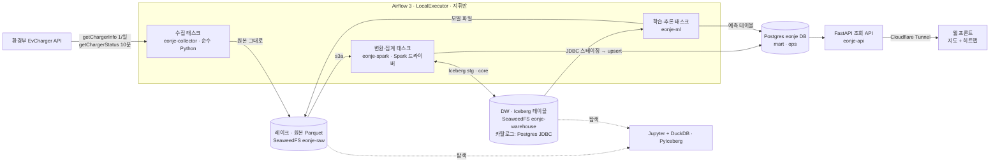

# 언제충전 (eonje) — 설계

EV 충전기 점유 패턴 서비스. 2026.10.09 시작.
서비스명 **언제충전**, 레포·패키지명 **`eonje`**. 요구사항은 [requirements.md](./requirements.md).
공개 API 기반 개인 프로젝트. 구현하면서 이 문서를 갱신한다.
2026.10.25 갱신: Spark 단일 엔진, 런타임별 이미지, 홈서버 노드 A/B, 서버에 코드를 두지 않는 CI/CD, GitDagBundle.

## 1. 서비스 정의

전국 전기차 충전기 상태를 계속 수집해, 공식 데이터가 주지 않는 **이력 기반 정보**를 제공한다.

- 사용자: 전기차 차주
- 핵심 기능 (우선순위 순)
  1. 충전소·충전기별 요일×시간대 점유 패턴 (언제 비는가)
  2. 장기 비정상 충전기 추적 (통신이상·운영중지·점검중이 며칠째 지속)
  3. 시설 유형·지역·운영기관별 점유 통계 (고속도로 휴게소 급속의 주말 오후, 아파트 완속의 야간 등)
  4. 예측 — 남은 충전 시간, 도착 시점 빈자리 확률 등. 처음엔 같은 요일·시간대 평균(베이스라인), 데이터가 쌓이면 모델 (10장, 요구사항 FR-40~49)
  5. (3단계) 요청 기반 빈자리 알림 — 이력·예측과 결합. 상세는 요구사항 FR-60~63
- 하지 않는 것: 지도 검색·결제·리뷰·상시 감시 알림. 기존 앱(EV Infra, 모두의충전, ChargEV 등)이 이미 함. 차별점은 이력.

## 2. 아키텍처

### 2.1 전체 구조



데이터는 한 방향으로만 흐른다: API → 원본(레이크) → 정제(`stg`) → 핵심(`core`: 팩트·디멘션) → 마트(`mart`) → 서빙. 역방향은 원본에서 재처리하는 경로 하나뿐이다.
수집은 순수 Python, **수집 이후의 모든 변환·집계는 Spark 단일 엔진**이다. 10분 증분과 백필이 같은 코드를 쓴다.

저장은 세 곳이고 역할이 겹치지 않는다 (2026.10.29 결정, 6장):
- **레이크** — SeaweedFS의 원본 Parquet. 받은 그대로 보존하고, 완료된 run은 바꾸지 않는다 (미완료 run만 비우고 다시 받음, 6장)
- **DW** — SeaweedFS 위 **Iceberg 테이블**(`stg`, `core`). 분석용 정제 데이터와 팩트·디멘션. Iceberg는 테이블 형식이라 새 상시 서비스가 없고, 카탈로그는 기존 Postgres에 둔다(JDBC 카탈로그)
- **서빙** — Postgres `eonje` DB(`mart`, `ops`). API가 읽는 집계, 10분마다 갱신되는 현재 상태, 호출 기록·품질 지표

DuckDB·PyIceberg는 원본과 Iceberg 테이블을 복사 없이 읽는 탐색용이고, 변환·서빙 경로에는 없다.

### 2.2 계층과 책임

| 계층 | 책임 | 하지 않는 것 |
|---|---|---|
| 수집 (ingest) | API 호출, 페이지 순회, 재시도, 호출 예산, 원본 저장. 순수 Python | 파싱·타입 변환·판단 |
| 원본 (raw) | 응답을 받은 그대로 보존. 전 컬럼 문자열. 재처리의 유일한 출발점 | 수정·삭제 |
| 정제 (transform) | 타입 변환, 중복 제거, 차원 SCD2, 전이 계산, 세션 복원, 보정. Spark | API 호출, 외부 I/O (Spark DataFrame in → DataFrame out) |
| DW (`stg`·`core`, Iceberg) | 정제 관측, 팩트(전이·세션), 디멘션(SCD2) 보관. 추가 위주이고, 기존 행을 바꾸는 건 세션 종료와 디멘션 버전 닫기뿐. 원본에서 언제든 다시 만든다 | 서빙 조회 (API는 마트만 읽음), 잦은 행 갱신 |
| 집계 (aggregate) | 요일×시간대 점유, 비정상 지속, 품질 지표. `core`(전이·세션·디멘션)와 `stg.obs_status`(관측, 결측 판정)에서 증분. Spark | 원본 접근 |
| 마트·운영 (`mart`·`ops`, Postgres) | API용 집계, 현재 상태(`charger_state`), 호출 기록, 품질 지표 | 이력 보관 (이력은 DW) |
| 예측 (ml) | 피처 생성(Spark), 학습(LightGBM 등), 배치 추론 → 예측 테이블 | 서빙 시점 추론 |
| 서빙 (serve) | 집계·예측 테이블 읽기 전용 API | 쓰기, 집계 계산 |
| 오케스트레이션 (Airflow) | 스케줄, 의존성, 재시도, 재실행 | 비즈니스 로직, 계산 분배 (Spark가 함) |

### 2.3 실행 모델 — 태스크는 런타임별 컨테이너에서

- **Airflow는 지휘만 한다.** 공식 이미지(DAG bundle용 git provider가 없으면 그것만 얹은 얇은 이미지). Airflow 이미지에 Spark·pandas·eonje 패키지를 넣지 않는다. DAG 파일은 `airflow`와 표준 라이브러리만 import
- **태스크 이미지는 런타임별로 나눈다.** Dockerfile은 `docker/` 아래 폴더 하나에 이미지 하나, 이미지 이름 = 폴더 이름

  | 이미지 | Dockerfile | 내용 | 쓰는 곳 |
  |---|---|---|---|
  | `eonje-collector` | `docker/tasks/collector/` | python:3.11-slim + uv + eonje (httpx, pyarrow, s3fs) | `fetch_*` |
  | `eonje-spark` | `docker/tasks/spark/` | Spark + PySpark + eonje + s3a·JDBC jar | Spark 드라이버(태스크), master, worker 공용 — 명령만 다름. Spark·Python 버전이 자동으로 일치 |
  | `eonje-ml` | `docker/tasks/ml/` | eonje + LightGBM 등 | 학습·배치 추론 (9단계) |
  | `eonje-api` | `docker/api/` | eonje + FastAPI | 조회 API |

- 태스크는 `DockerOperator(image="<EONJE_IMAGE_REPO>-<runtime>:<EONJE_IMAGE_TAG>", command=["<job>", "--run-id", "{{ run_id }}", "--run-after", "{{ dag_run.run_after.isoformat() }}"])`. 이미지 진입점이 `python -m eonje.cli`라 명령에는 job과 인자만 준다. `--run-after`(ISO 8601, 오프셋 필수)가 수집 시각과 날짜 파티션을 정하므로 둘 다 필수다
  - `@task.docker`가 아니라 `DockerOperator`인 이유: `@task.docker`는 DAG 파일의 Python 함수를 직렬화해 컨테이너에서 실행한다. 우리 태스크는 이미지 안의 `eonje` 패키지와 CLI를 그대로 실행하므로 이미지 + 명령을 받는 `DockerOperator`가 맞다 (2026.10.31)
  - 설정 전달: `EONJE_*` 값(서비스 키 포함)은 scheduler 컨테이너만 `.env`에서 받고, 태스크가 **실행될 때** 그 환경에서 읽어 `private_environment`로 넘긴다(`dags/`의 `EonjeTask`). DAG 파싱 때 넘기면 직렬화된 DAG로 Airflow DB에 남는다. 컨테이너 네트워크 안 주소(`postgres`, `seaweedfs`)는 compose가 scheduler 환경에서 덮어쓴다
  - `skip_on_exit_code=99`(예산 소진·늦은 run은 skipped), `do_xcom_push=False`(컨테이너 마지막 로그 줄을 XCom에 쌓지 않음), `mount_tmp_dir=False`
- 태스크 간 데이터는 XCom이 아니라 SeaweedFS·DB를 거친다. XCom은 run_id·건수·페이지 상한 같은 작은 값만
- 네트워크: 수집 태스크는 compose 네트워크에 붙어 Postgres·SeaweedFS에 접근. Spark 드라이버 태스크는 `network_mode: host` (다른 노드의 executor가 드라이버에 접속해야 함, 8.2)
- 원격 실행: 모델 학습 등 Spark가 아닌 무거운 태스크는 `DockerOperator(docker_url=<B>)`로 B 노드의 Docker에서 실행 (8.1)
- 효과: Airflow와 파이프라인 의존성 완전 분리. "`eonje`는 Airflow 없이 돈다"는 경계가 런타임에서 강제됨. 이미지가 런타임별이라 수집 이미지에 Spark가 없고, Spark 이미지 크기가 수집 배포를 느리게 하지 않는다
- 비용: scheduler에 `/var/run/docker.sock` 마운트(호스트 root 상당 권한 — 1인 홈서버에서 감수), 태스크당 컨테이너 기동 수 초(10분 주기엔 무시)

### 2.4 모듈 경계 — 레포 구조

```
eonje/
  eonje/                  # 순수 Python 패키지. Airflow를 import하지 않는다
    cli/                  # 태스크 진입점: `python -m eonje.cli <job> --run-id ... --run-after ...`
      __main__.py         # app.main 위임만
      app.py              # 인자 파싱, 설정 로드, job 디스패치, 종료 코드
      registry.py         # job 이름 → 함수 매핑
      jobs/               # job 하나 = 모듈 하나 = DAG 태스크 하나. 의존성 생성과 결과 → 종료 코드 변환만, 로직 없음
    config.py             # 설정값 (한도·간격·지역·페이지 크기·Spark master 등). EONJE_ 환경변수·.env에서 로드
    client/               # API 클라이언트: 요청 조립, 페이지네이션, 재시도, 응답 검증
    budget/               # 호출 예산: 오늘 사용량 조회, 실행 가능 여부·페이지 상한 판단
    collect/              # 수집 흐름: 완료·지연 확인 → 예산 판단 → 페이지 순회 → 원본 run 쓰기. client·budget·storage를 조합하고, HTTP·파일시스템·DB 세션은 주입받는다
    storage/
      raw.py              # 원본 Parquet 경로 규칙, 쓰기(수집) — pyarrow + s3fs
      spark.py            # SparkSession 생성(설정·Iceberg 카탈로그 주입), s3a 읽기, JDBC 스테이징 쓰기
      iceberg.py          # Iceberg 테이블 정의(스키마·파티션)의 단일 출처. 멱등한 생성·컬럼 추가로 적용 (3단계)
      models.py           # SQLAlchemy ORM 모델 (Postgres 스키마 mart·ops의 단일 출처. Alembic autogenerate 대상)
      db.py               # 엔진·세션, 스테이징 → INSERT ... ON CONFLICT 반영
    transform/            # 순수 함수. Spark DataFrame in → DataFrame out. I/O 없음
      dims.py             # SCD2 비교·갱신 행 생성
      observations.py     # API 어휘 → 내부 어휘, 타입 변환, run 안 중복 제거 (observed_at = run의 collected_at)
      transitions.py      # charger_state와 비교 → 전이 이벤트
      sessions.py         # last_ts/last_te/now_ts → 세션 upsert 행
      reconcile.py        # 전체 스냅샷 vs 추적 상태 불일치 → 보정 전이
      aggregate.py        # 점유·비정상·품질 지표
    codes/                # 코드표 (버전별 YAML) + 로더
  api/                    # FastAPI. 집계·예측 테이블 read-only. eonje.storage.models를 그대로 조회
  dags/                   # 얇은 DAG. DockerOperator로 eonje.cli 호출만. 패키지가 아닌 폴더(__init__.py 없음). 개발 PC는 마운트, 운영은 GitDagBundle
    ev_master_daily.py
    ev_status_10min.py
    ev_transform_10min.py # 4단계 (분리 후보, 7장)
    ev_aggregate_hourly.py
    lake_maintenance_daily.py
  docker/
    tasks/collector/Dockerfile
    tasks/spark/Dockerfile
    tasks/ml/Dockerfile   # 9단계
    api/Dockerfile
  web/                    # 프론트 (후순위)
  docs/                   # 이 문서들
  infra/
    compose.node-a.yaml   # 상시 노드: airflow, postgres, seaweedfs, spark master·worker, eonje-api, cloudflared. 개발 PC도 이것을 사용
    compose.node-b.yaml   # 보조 노드: spark worker, 모니터링, 로컬 백업 (B 추가 시)
    postgres/init.sh      # 첫 기동 시 airflow·eonje DB와 역할 생성. 비밀번호는 .env (compose configs로 주입)
    migrations/           # Alembic — models.py에서 autogenerate, 검토 후 커밋
    .env.example
  tests/
    unit/                 # transform·budget·client·cli 단위 테스트 (Airflow·네트워크 없이). Spark 변환은 로컬 SparkSession
    fixtures/             # 실제 API 응답 샘플 (키 제거)
  .github/workflows/
    ci.yml                # ruff, mypy, pytest, 이미지 빌드 (PR)
    cd.yml                # GHCR 푸시 + 노드 배포 + deploy ref 이동 (main)
```

경계 규칙:
- **Airflow를 아는 코드는 `dags/`뿐.** `eonje`는 Airflow 없이 import·테스트되고, 런타임에서도 별도 컨테이너라 Airflow 패키지가 아예 없다. CLI로 백필할 때도 같은 진입점.
- **외부 I/O를 아는 코드는 `client/`와 `storage/`뿐.** SparkSession 생성, s3a 읽기, JDBC 쓰기도 `storage/`에 둔다. `transform/`은 DataFrame만 받는 순수 함수라 로컬 SparkSession과 fixture로 테스트한다.
- **API 어휘(`statId`, `chgerId`, `stat`…)는 `observations.py`에서 내부 어휘(`stat_id`, `charger_id`, `status_code`)로 한 번 번역**하고, 그 아래로는 내부 어휘만 쓴다. 응답 필드가 바뀌어도 수정 지점은 한 곳.
- 설정값은 `config.py`에서만 읽는다. DAG 스케줄 간격도 거기서 가져온다 (DAG 파일은 환경변수를 직접 읽음 — eonje import 불가).
- **`__init__.py`에는 로직을 두지 않는다.** 전부 빈 파일. re-export도 하지 않아 import는 항상 모듈까지 적는다 (`from eonje.cli.app import main`). `__main__.py`는 위임 두 줄만.
- **스키마의 단일 출처는 저장소마다 하나.** Postgres(`mart`·`ops`)는 `models.py` — 파이프라인 적재와 API 조회가 같은 모델을 쓰고, Alembic이 여기서 만든다. Iceberg(`stg`·`core`)는 `storage/iceberg.py` — Alembic 대상이 아니므로 정의를 코드로 두고 멱등한 생성(`CREATE TABLE IF NOT EXISTS`)·컬럼 추가 잡(`ensure-iceberg-tables`)으로 적용한다. 두 스키마 모두 CD가 배포 때 적용한다 (8.3).
- 대량 적재: Postgres는 Spark → JDBC 스테이징 테이블 → `INSERT ... ON CONFLICT`, Iceberg는 Spark `MERGE INTO`(키가 있는 테이블은 전부. 단순 `append`는 고유 제약이 없어 재실행 시 중복을 만든다). 행 단위 `session.add`는 금지.
- **Spark 규칙 (처음부터 지킨다):** 데이터는 `s3a://`(SeaweedFS), Iceberg 카탈로그, JDBC로만 읽고 쓴다 — 로컬 경로 금지(다른 노드의 executor가 못 읽음). **Iceberg 테이블은 카탈로그 이름으로만** 읽고 쓴다 (경로로 Parquet을 직접 쓰면 테이블 메타데이터에 안 잡힌다). jar·패키지는 전부 이미지에 넣는다. 큰 데이터에 `collect()`·`toPandas()` 금지. `spark.sql.session.timeZone=Asia/Seoul`을 명시한다.

### 2.5 런타임 토폴로지


- **원칙: 상태를 가진 것(Postgres·SeaweedFS)과 수집 경로·Airflow는 A에만 둔다.** B가 꺼져도 A의 수집은 계속되고, B는 A를 계산·감시·보관하는 보조 노드다. 서비스 배치는 고정 (8.1)
- **공유기 포트는 열지 않는다.** 공개 트래픽은 Cloudflare Tunnel(나가는 연결)로 `eonje-api`에만, 관리 접근(SSH·Airflow·Spark·SeaweedFS UI·Grafana)은 Tailscale로만
- 로컬 개발 PC는 `compose.node-a.yaml`을 그대로 쓰고 Spark는 `local[*]`. 차이는 `.env`뿐
- **Postgres는 인스턴스 하나, 데이터베이스 둘**(`airflow`, `eonje`)에 역할도 둘. `init.sh`로 첫 기동 시 생성(역할 비밀번호는 `.env`에서 받아 레포에 남지 않음). Airflow 메타DB를 초기화·교체해도 `eonje` DB는 무관하고, 백업은 DB 단위 `pg_dump`
- 원본 저장소는 **SeaweedFS**(S3 호환, 단일 노드는 `weed server -s3` 컨테이너 하나). `storage/`는 S3 프로토콜만 쓰므로(s3fs 수집, s3a Spark) 다른 S3 호환 저장소로 옮겨도 엔드포인트만 교체. 작은 파일을 큰 볼륨 파일에 묶어 저장해서, run마다 작은 Parquet이 쌓이는 원본에 유리하다

### 2.6 처리 흐름 요약

```
[10분마다]  수집: 예산 확인 → period=10 전 페이지 → raw 저장                     (레이크)
            변환: 미처리 run을 수집 시각 순으로 (delta·full 함께)
            → 타입 변환·run 안 중복 제거 → stg.obs_status                         (DW)
            → ops.charger_state와 비교 → core.evt_transition, charger_state 갱신   (DW → 서빙)
              (full run이면 불일치를 보정 전이 source=reconciled로)
            → last_ts/last_te/now_ts → core.fact_session MERGE                     (DW)

[1일 1회]   53페이지 수집 → raw 저장 (위 변환 흐름이 순서대로 처리)
            → core.dim_station·dim_charger SCD2

[1일 1회]   Iceberg 유지보수 (별도 DAG): 작은 파일 합치기, 오래된 스냅샷·고아 파일 정리

[매시]      변환 워터마크까지의 core·stg.obs_status → mart.agg_occupancy_hourly, agg_station_hourly
            → mart.agg_abnormal, ops.quality_metrics
```

역할: 10분 수집은 **움직임**(변경분), 일 1회 수집은 **전체 모습과 정답지**(마스터 + 보정), 매시 집계는 **사용자용 요약**. 집계는 API 호출 없음.
정제·전이·세션·집계는 Spark 태스크이고, 미처리 원본 run을 전부 처리하는 워터마크 방식이라 변환이 멈췄다 살아나도 따라잡는다 (7장).

## 3. 기술 스택

선택 기준: 1인 운영 가능, 개발 PC와 운영 노드가 같은 구성, 바꿀 때 한 곳만 바꾸면 될 것.

| 영역 | 선택 | 이유·비고 |
|---|---|---|
| 언어 | Python 3.11 (파이프라인·API), TypeScript (프론트) | |
| 패키지 관리 | uv (`pyproject.toml`, lock) | 설치 빠름. 모든 이미지 빌드에 사용 |
| 오케스트레이션 | Apache Airflow 3.3 공식 이미지 + docker·git provider를 constraints로 고정한 얇은 이미지(`docker/airflow/`), LocalExecutor | Airflow는 지휘만. 계산 분배는 Spark. 로그인은 SimpleAuthManager(비밀번호는 `.env`) |
| DAG 배포 | Airflow 3 DAG bundle (`GitDagBundle`) | Git `deploy` ref를 추적. run마다 DAG 버전 기록. 서버에 DAG 파일을 두지 않음 (8.3) |
| 태스크 실행 | Docker provider `DockerOperator`, 런타임별 이미지 | 기본은 A의 Docker, 학습 등은 `docker_url`로 B |
| HTTP 클라이언트 | httpx + tenacity | 동기로 충분(페이지 순차). 재시도·백오프는 tenacity |
| 설정 | pydantic-settings | `EONJE_` 환경변수 → 타입 검증된 설정 객체. `config.py` 하나 |
| 수집 저장 | pyarrow + s3fs | 수집은 Spark 없이 Parquet 쓰기만 |
| 변환·집계 | **Apache Spark (PySpark), standalone 클러스터, client 모드** | 단일 엔진. 10분 증분과 백필이 같은 코드. 노드 추가 시 worker만 붙임 (8.2) |
| 원본 저장 | Parquet, SeaweedFS (S3 호환, `weed server -s3`) | 수집은 s3fs, Spark는 s3a. S3 접속 키는 SeaweedFS S3 identity 설정(JSON)으로, 버킷은 `weed shell`의 `s3.bucket.create`로 만든다 |
| DW 테이블 | **Apache Iceberg** (SeaweedFS `eonje-warehouse` 버킷, JDBC 카탈로그는 Postgres `eonje` DB) | Parquet 파일 묶음을 원자적 커밋·스키마 변경·시간 여행·`MERGE`가 되는 테이블로. 새 상시 서비스 없음. Spark가 쓰고 DuckDB·PyIceberg가 복사 없이 읽는다. SeaweedFS·Spark와의 호환은 3단계 첫 작업으로 확인 (11장) |
| 서비스 DB | PostgreSQL 16 (1 인스턴스, `airflow`·`eonje` 2 DB), SQLAlchemy 2 ORM (Declarative, `Mapped[]`), psycopg 3, Alembic | 마트·현재 상태·운영 테이블. 모델이 Postgres 스키마·마이그레이션·API 조회의 단일 출처. 적재는 Spark JDBC 스테이징 → `INSERT ... ON CONFLICT` |
| 예측 | LightGBM, 생존분석 등 표 데이터 모델 | 주 1회 학습(B), 매시 배치 추론 → 예측 테이블. 서빙은 테이블 조회만 (10장) |
| 자연어 요약 | 외부 LLM API | 자체 호스팅 안 함. 생성한 문장만 저장 |
| 분석 | Jupyter + DuckDB, PyIceberg | 원본 Parquet·Iceberg 테이블 탐색·검증. 변환·서빙 경로에는 안 씀 |
| API | FastAPI, pydantic v2, uvicorn | `/v1/` 버전 고정. 응답 스키마 = 프론트·모바일 공통 계약 |
| 프론트 | React + TypeScript + Vite | 정적 SPA. API만 호출, 로직 없음. 배포 방식은 미결(12장) |
| 지도 | Kakao Maps JS SDK | 국내 지도 품질·무료 쿼터. 모바일은 네이티브 SDK로 교체, 데이터는 동일 |
| 차트 | Apache ECharts | 히트맵 내장. 7×24 격자 |
| 공개·TLS | Cloudflare Tunnel + Cloudflare DNS (무료 플랜) | 포트포워딩·고정 IP·인증서 관리 없음. 집 IP 비노출, 기본 DDoS 방어 |
| 관리 접근 | Tailscale | SSH, Airflow·Spark·SeaweedFS·Grafana UI. CD 러너도 tailnet으로 접속 |
| 컨테이너 | Docker, docker compose (노드별 파일) | 개발 PC = 노드 A 구성 |
| 이미지 레지스트리 | GHCR (`ghcr.io/jungyu333/eonje-*:<git-sha>`) | Actions `GITHUB_TOKEN`으로 푸시. 공개 이미지라 서버 pull에 인증 불필요. compose와 DAG는 이미지 이름을 `${EONJE_IMAGE_REPO}-<runtime>:${EONJE_IMAGE_TAG}`로 만든다: 개발 PC `eonje`·`dev`(`make build`), 운영 `ghcr.io/jungyu333/eonje`·git sha |
| 운영 노드 | 집 미니PC (A 상시, B는 부족 신호 시 추가) | 8.1 |
| 테스트 | pytest, 실제 응답 fixture, 로컬 SparkSession | `transform/`은 fixture로 커버. DB 테스트는 `db` 마커 + Actions `services:` Postgres |
| 품질 | ruff (lint·format), mypy strict, pre-commit | pre-commit 훅: ruff(프로젝트 venv 버전), ruff-format, EOF·공백·YAML·TOML 검사, 대용량 파일·개인키 차단. mypy는 CI |
| CI | GitHub Actions | PR: ruff + mypy + pytest, collector 이미지 스모크, Airflow 이미지 + DAG 무결성 검사, DB 테스트. main: 전부 통과하면 이미지를 GHCR에 `<sha>`로 푸시 |
| CD | GitHub Actions + Tailscale + SSH | main: 이미지 GHCR 푸시 → 노드에 compose 배포 → 헬스체크 → `deploy` ref 이동 (8.3) |
| 알림·관측 | A 단독: 텔레그램 봇. B 추가 후: Prometheus + Grafana + Loki (B에서 실행) | A가 죽어도 B에서 알림 발송 |
| 백업 | 로컬: B로 버킷 동기화(`weed filer.sync` 또는 rclone)·`pg_dump`. 오프사이트: R2 또는 B2 | 8.5 |
| 시크릿 | 노드의 `.env`(서버에서 직접 관리), GitHub Secrets(배포 SSH 키, Tailscale OAuth) | 레포에는 `.env.example`만 |

보류한 것: Kubernetes·k3s(compose로 시작, B 추가 시 재검토 — 8.6), Celery/Redis(LocalExecutor로 충분), dbt(변환이 Spark 코드로 충분), Kafka 등 스트리밍(10분 배치면 됨), async SQLAlchemy(읽기 전용 API에 이득 적음), pandas·DuckDB 변환 경로(Spark 단일 엔진으로 통일), 포트포워딩 + certbot(Cloudflare Tunnel로 대체), self-hosted Actions runner(public 레포에서 fork PR 코드가 서버에서 돌 위험), LLM 자체 호스팅, Postgres 인스턴스 분리(DB 분리로 충분), MinIO(2025.10 커뮤니티 Docker 이미지·바이너리 배포 중단, 2026.04 저장소 아카이브 → 보안 패치 없음. 작은 파일 대량 저장에 유리하고 유지보수가 활발한 SeaweedFS로 대체, 2026.10.28), ClickHouse·Trino 같은 별도 조회 엔진(대화형 SQL이 필요해지면 B에 Iceberg를 읽는 엔진으로만 붙인다. 데이터는 갖지 않음, 2026.10.29), 관리형 DW(BigQuery·Snowflake — 비용, 홈서버 운영 원칙과 맞지 않음), Postgres 안의 `stg`·`core` 스키마(Iceberg 호환 확인이 실패할 때의 전환 경로, 11장).

## 4. 데이터 소스

한국환경공단 "전기자동차 충전소 정보" OpenAPI (공공데이터포털, 서비스 `B552584/EvCharger`). 활용가이드 v1.25 (2026.07.01). 개발계정 **일 1,000회**.

Base: `https://apis.data.go.kr/B552584/EvCharger/`

| 오퍼레이션 | 용도 | 주요 파라미터 | 응답 |
|---|---|---|---|
| `getChargerInfo` | 충전기 마스터 + 현재 상태 | `zcode`, `zscode`, `kind`, `kindDetail`, `statId`, `chgerId` | 40여 필드 |
| `getChargerStatus` | 상태만 (경량) | `period`(분, 1~10, 기본 5) + 위 필터 | `busiId statId chgerId stat statUpdDt lastTsdt lastTedt nowTsdt` |

공통: `serviceKey`, `pageNo`, `numOfRows`(10~9,999), `dataType=JSON`. 응답 `resultCode`, `totalCount`, `items.item[]`.

### 실측 (2026.10.09 금 14:00~14:20 KST)

| 호출 | totalCount | 비고 |
|---|---|---|
| `getChargerInfo` 전체 | **526,239** | 9,999건씩 53페이지 |
| `getChargerInfo zcode=11` (서울) | **76,005** | 14.5%, 8페이지 |
| `getChargerStatus period=10` | **13,668** | 전국의 2.6%, 2페이지 |
| `getChargerStatus period=1` | **0** | 비정상. 상류 배치 반영 지연 또는 하한 미준수로 추정. 짧은 period 사용 안 함 |

### 필드에서 확인된 사실

- `statUpdDt`는 운영기관마다 의미가 다르다. 환경부(ME) 충전기는 상태 변화 없이도 15분쯤마다 갱신됨(주기 보고). 전체 2.6%만 10분 내 갱신이므로 다른 기관은 변경 시만 올리는 것으로 보임. → **전이 시각으로 쓰지 않는다.** 관측으로 저장하고 전이는 직전 상태와 비교해 계산.
- 실제 전이도 잡힌다: `stat=3`이 되며 `nowTsdt`와 `statUpdDt`가 1초 차이로 기록됨.
- `lastTsdt`/`lastTedt`(마지막 충전 시작·종료)가 충실히 채워짐. 전이를 놓쳐도 충전기별 마지막 세션은 복원 가능. 50kW 급속 세션은 대략 20~40분.
- `nowTsdt`는 충전 중일 때만 값이 있음.
- `statId`는 숫자 8자리가 아니라 `ME174013`처럼 기관 코드 접두 문자열.
- `maker`(제조사) 필드가 문서에 없는데 옴. `powerType`은 빈 값. → 원본은 가공 없이 저장.
- 상태 코드가 문서 두 곳에서 다름. 필드 설명: 0 알수없음 / 1 통신이상 / 2 사용가능 / 3 충전중 / 4 운영중지 / 5 점검중. 공통코드표: 2 충전대기, 6 예약중, 9 상태미확인 추가. → enum 고정 금지. 미지 코드도 저장, 집계 시 매핑.
- 요청 명세에 `statId`·`chgerId`가 필수로 표기돼 있으나 없어도 호출됨 (표기 오류).
- 정렬이 기관·등록 순이라 한 페이지로 분포 추정 불가.
- 지역 코드가 2026년에도 계속 변경됨(v1.25, "12 전남광주통합특별시"). 코드표는 버전 관리되는 참조 데이터로.
- 키: 브라우저는 Encoding 키, `requests params=`는 Decoding 키.

### 차원으로 쓸 수 있는 마스터 필드

`kind`/`kindDetail`(시설 유형 10/70여 종), `zcode`/`zscode`(시도/시군구), `busiId`(운영기관 140여), `chgerType`(11종, NACS 포함), `output`(kW), `method`(단독/동시), `limitYn`/`limitDetail`, `parkingFree`, `useTime`, `year`(설치년도), `floorType`/`floorNum`, `delYn`/`delDetail`(철거 이력), `maker`.

## 5. 수집 전략

호출 한도가 설계를 결정한다. 한도·간격·지역은 전부 설정값이고, 운영계정 전환 시 설정만 바꾼다.

| 수집 | 주기 | 호출/일 | 내용 |
|---|---|---|---|
| 마스터 전체 | 1일 1회 | 53 | `getChargerInfo` 전 페이지. 차원 갱신 + 그날의 전체 상태 기준점 |
| 상태 변경분 | 10분 | 144 × 2~3 = 288~432 | `getChargerStatus period=10 numOfRows=9999` 전 페이지 |
| 여유 | | ~500 | 재시도, 수동 조회, (3단계) 알림용 집중 폴링 |

- 초기값 10분 간격. 며칠 `totalCount` 분포(특히 저녁 피크)를 쌓은 뒤 간격 조정. 5분 간격은 최대 917회로 한도에 붙어 보류.
- `period=10`에 10분 간격이면 겹침이 없다. 호출 실패 시 그 10분의 전이는 잃지만 `lastTsdt`/`lastTedt`로 세션은 다음 관측에서 복원됨. 겹침(5분 간격)으로 가면 같은 보고(`statUpdDt`가 같음)가 두 run에 보인다. 관측은 run마다 남기고(그 시각에도 그 상태였다는 사실이라 결측 판단에 쓰임), 전이는 상태가 같으면 생기지 않으므로 중복이 생기지 않는다 (6장).
- **예산 관리자** (`budget/policy.py`, 순수 함수):
  - 모든 HTTP 시도(재시도 포함)를 시도마다 독립 트랜잭션으로 `api_call_log`에 기록한다. 태스크가 롤백돼도 기록은 남는다 (기록이 사라지면 사용량을 적게 센다)
  - "오늘"은 KST 자정 기준 하루 `[00:00, 다음 날 00:00)`
  - 상한 = `floor(EONJE_API_DAILY_LIMIT × EONJE_BUDGET_SAFETY_RATIO) − EONJE_BUDGET_RESERVE_CALLS`. 기본 1000 × 0.95 − 0 = 950 (NFR-01: 한도 95% 전에 멈춤)
  - 남은 호출 = 상한 − 오늘 사용량. 페이지마다 최대 `api_max_attempts`번 시도하므로 **페이지 상한 = 남은 호출 // api_max_attempts**. 재시도가 몰려도 한도를 넘을 수 없다. 1페이지도 안 되면 그 run은 호출 없이 건너뛴다
  - 첫 버전(2단계)의 단순화: 남은 호출을 지금 run에 모두 허용한다. 평소 사용량(하루 약 485회)이 상한보다 한참 낮아서다. **잔여 실행 횟수에 맞춘 배분은 5단계**, **마스터 DAG 몫 예약(`EONJE_BUDGET_RESERVE_CALLS`를 마스터 1회분 = 53 × api_max_attempts 이상으로)은 마스터 수집이 생기는 3단계**에서
  - 동시 실행 경쟁: 판단(`count_calls` → `decide`)과 호출 사이에 다른 수집 잡이 호출하면 두 잡이 같은 사용량을 보고 각자 상한만큼 쓸 수 있다. 지금은 수집 잡이 `fetch_delta` 하나이고 안전 비율·예약분이 흡수한다. **`fetch_master`가 생기는 3단계에서 수집 잡을 직렬화한다**: Airflow pool `evcharger_api`(슬롯 1)에 두 수집 태스크를 넣는 것이 기본안. 수동 CLI 실행까지 막아야 하면 수집 동안 Postgres advisory lock(`pg_advisory_lock`)을 잡는다
- 페이지 사이 상태 변화: 한 수집 안에서 페이지가 다른 시각에 조회되므로, 관측 시각은 페이지 응답 시각이 아니라 **수집 시작 시각(버킷)**으로 통일. 원본에는 페이지 응답 시각도 남김.
- 페이징 드리프트 (2026.10.29 첫 실수집에서 확인): 페이지를 받는 사이에 최근 N분 창이 움직여 `totalCount`가 바뀐다. 실측 1페이지 13,297 → 0.9초 뒤 2페이지 13,290, 받은 행 13,290 (모두 고유, 중복 없음). 응답이 `statUpdDt` 순으로 정렬돼 있지 않아서, 행이 빠지면 페이지 경계의 행이 어느 페이지에도 안 들어갈 수 있다 (누락).
  - manifest에 `page_size`, `expected_pages`를 남긴다. 받은 페이지 < `expected_pages`면 **예산 잘림**, 다 받았는데 `row_count ≠ total_count`면 **드리프트** (`drift = total_count − row_count`, 양수는 누락, 음수는 중복 가능성)로 구분해 경고한다
  - 드리프트 크기를 4단계 품질 지표(`ops.quality_metrics`)로 쌓는다. 누락은 다음 관측의 `lastTsdt`/`lastTedt`(세션 복원)와 마스터 대조(스냅샷 보정)로 메운다
  - 간격 재검토 (2단계 `ev_status_10min` DAG 작업 때): 10분 간격 + `period=10`은 겹침이 0이라 스케줄 지연만큼 창 사이에 틈이 생긴다. 피크 `totalCount` 실측 후 5분~8분 간격(겹침)을 예산과 함께 결정
- 스냅샷 보정: 마스터 전체 조회의 `stat`를 기준점으로 삼아, 변경분으로 추적 중인 상태와 불일치하는 충전기를 찾아 보정 이벤트를 만든다 (놓친 전이의 사후 기록). 불일치 비율을 지표로 남긴다. full run도 delta run과 같은 변환 흐름에서 수집 시각 순서대로 처리해, 보정이 밀린 delta보다 먼저 일어나지 않게 한다 (7장).

## 6. 데이터 모델

### 원본 (Parquet, SeaweedFS, run 단위)

경로 (`storage/raw_paths.py`). 버킷은 `EONJE_RAW_BUCKET`, 접속은 `EONJE_S3_ENDPOINT_URL`·`EONJE_S3_ACCESS_KEY`·`EONJE_S3_SECRET_KEY`. 경로에는 스킴이 없고, 수집기(s3fs)는 그대로, Spark는 `s3a://`를 붙여 쓴다.

```
{bucket}/charger_status/dt=YYYY-MM-DD/run=<run_key>/page=NNN.parquet
{bucket}/charger_status/dt=YYYY-MM-DD/run=<run_key>/_manifest.json
{bucket}/charger_info/...   (같은 구조)
```

- **`dt`는 수집 시각(`collected_at`)의 KST 날짜**(`partition_date`). 기록기가 `run.dt`와 맞지 않으면 거부한다 → 같은 run이 두 날짜 파티션에 생기지 않는다
- `run_key`는 경로에 안전한 문자만(`[0-9A-Za-z_.-]`). Airflow run_id에서 결정적으로 만든다 (`run_key_from_run_id`)
  - 이미 안전한 run_id는 그대로 쓴다. 문자를 `-`로 바꾸거나 앞에 `r`을 붙였다면 끝에 `-<원문 sha256 앞 8자>`를 붙인다
  - 이유: 치환만 하면 서로 다른 run_id(`a:b`, `a/b`, `a-b`)가 같은 `run=` 폴더가 되어, 한 run이 다른 run의 원본을 덮어쓴다
  - 예: `scheduled__2026-10-26T01:10:00+00:00` → `scheduled__2026-10-26T01-10-00-00-00-<hash8>`
- 컬럼: 응답 item의 필드 전부를 **string**으로 받은 그대로(미지 필드 유지, 문자열이 아닌 JSON 값은 JSON 표기 그대로) + 메타 `collected_at`(timestamp UTC), `page_fetched_at`(timestamp UTC), `page_no`(int32). 타입 변환은 정제 단계에서
- 스키마는 페이지에 나온 필드로 정해져 페이지·run마다 컬럼 구성이 다를 수 있다. Spark는 `mergeSchema`로 읽는다 (전부 string이라 타입 충돌 없음)
- 시각은 모두 시간대가 있어야 하고 UTC로 저장한다. 시간대 없는 시각은 거부

쓰기 규칙 (`storage/raw.py`, `storage/raw_run.py`):
- 페이지는 메모리 버퍼에 Parquet(zstd)으로 다 쓴 뒤 한 번에 올린다 → 실패하면 객체가 생기지 않는다
- run은 `start → write × N → finish`. `start`는 **manifest를 먼저 지우고** run 폴더를 비운다(재실행 때 지난 페이지가 남지 않음). `finish`는 모든 페이지를 쓴 뒤 **`_manifest.json`을 마지막에** 쓴다
- **manifest가 있는 run만 완료된 run이다.** 읽는 쪽(Spark 워터마크)은 manifest가 없는 run을 건너뛴다. 중간 실패·정리 실패 모두 manifest가 없는 상태로 남는다
- manifest: `version, dataset, operation, dt, run_key, collected_at(UTC), total_count(1페이지 값), row_count, page_size, expected_pages, pages`. 완료 시각처럼 재실행마다 바뀌는 값은 넣지 않는다. 받은 페이지 < `expected_pages`면 예산 상한으로 잘린 run, 페이지를 다 받았는데 `row_count ≠ total_count`면 페이징 드리프트 (5장)
- **완료된 run은 다시 받지 않는다** (2026.10.29). API는 '지금부터 최근 N분'만 주므로, 같은 run을 나중에 받으면 다른 데이터에 예전 `collected_at`이 붙고 `start`가 원래 원본을 지운다. 원본은 다시 받을 수 없다
  - manifest가 있으면 호출 없이 성공 (종료 코드 0)
  - `run_after`가 지금과 `EONJE_FETCH_MAX_LAG_MIN`(기본 = `EONJE_STATUS_PERIOD_MIN`, 그보다 클 수 없음)보다 멀면 호출 없이 건너뜀 (99). 밀린 run, catchup
  - manifest가 없는 run(중간 실패)만 run 폴더를 비우고 다시 받는다. 다시 수집하고 싶으면 새 run_id
- 원본은 run 단위로 덮어쓸 수 있지만, 한 번 완료된 run의 내용은 같은 입력이면 같다 (멱등)

### DW (Iceberg `stg`·`core`, `storage/iceberg.py`)

- 위치: SeaweedFS `eonje-warehouse` 버킷(`s3a://eonje-warehouse/`). 카탈로그는 Iceberg JDBC 카탈로그로 Postgres `eonje` DB의 `iceberg` 스키마에 둔다. Spark 카탈로그 이름은 `lake` (`lake.stg.obs_status`)
- 카탈로그 테이블(`iceberg_tables` 등)은 Iceberg가 만든다. Alembic이 지우려 들지 않도록 마이그레이션 비교에서 `iceberg` 스키마를 뺀다
- 스키마 정의는 `storage/iceberg.py` 하나. 적용은 멱등한 잡(`CREATE TABLE IF NOT EXISTS`, 없는 컬럼만 `ADD COLUMN`). 컬럼 삭제·타입 변경은 하지 않고 새 컬럼으로 옮긴다
- 날짜 파티션은 KST 날짜 컬럼(`*_date`)을 따로 두고 그 값으로 나눈다. Iceberg의 `days()` 변환은 UTC 기준이라 KST 날짜와 어긋난다

| 테이블 | 한 행 (grain) | 키 | 쓰기 방식 | 파티션 | 주요 컬럼 |
|---|---|---|---|---|---|
| `stg.obs_status` | 충전기 1대가 한 run에서 관측된 1회 (`observed_at` = run의 `collected_at`) | `stat_id, charger_id, run_key` | 추가만. 키가 이미 있으면 무시 (`MERGE ... WHEN NOT MATCHED INSERT`). 적재 전 run 안 중복(페이징 드리프트)은 키당 하나로 줄이고, 고르는 기준은 결정적이어야 한다: `stat_upd_dt`가 늦은 행 → `page_no`가 큰 행(나중에 받은 페이지) → 그래도 같으면 나머지 컬럼 값의 사전순. 원본에서 다시 만들어도 같은 행이 남는다. run이 달라 같은 보고가 다시 보이면 별개의 관측으로 남긴다. 키에 `observed_at`이 아니라 `run_key`를 쓰는 이유: `collected_at`은 Airflow 논리 시각(`run_after`)이라 delta run과 full run이 같은 시각을 가질 수 있다 | `observed_date` | `status_code`, `stat_upd_dt`, `last_ts`, `last_te`, `now_ts`, `source`(delta/full), `run_key` |
| `core.evt_transition` | 충전기 1대의 상태 변화 1회 (그것을 발견한 run 하나에 속함) | `stat_id, charger_id, at, run_key` | 추가만. 키가 이미 있으면 무시 (`MERGE ... WHEN NOT MATCHED INSERT`). 놓친 전이는 `source=reconciled` 새 행으로 | `at_date` | `from_status`, `to_status`, `at`(전이 추정 시각), `detected_at`, `source`(observed/reconciled) |
| `core.fact_session` | 충전 세션 1회 | `stat_id, charger_id, started_at` | `MERGE` (진행 중 세션이 끝나면 갱신) | `started_date` | `ended_at`, `duration_min`, `source`(last_ts/now_ts) |
| `core.dim_station` | 충전소 1곳의 한 버전 | `stat_id, valid_from` | SCD2, 하루 1번 (`MERGE`: 바뀐 행은 현재 버전을 닫고 새 버전 추가) | 없음 | 이름·주소·좌표·시설 유형·지역·운영기관·이용시간·주차료·이용제한, `valid_to`, `is_current` |
| `core.dim_charger` | 충전기 1대의 한 버전 | `stat_id, charger_id, valid_from` | SCD2, 하루 1번 (`MERGE`) | 없음 | 타입·출력·방식·제조사·설치년도·층·삭제 여부, `valid_to`, `is_current` |
| `core.dim_date` | 날짜 1일 | `date` | 정적. 공휴일이 바뀌면 테이블 전체 덮어쓰기 (작은 정적 테이블이라 `MERGE` 규칙의 예외) | 없음 | 요일, 주말, 공휴일 |

- 팩트는 **추가만** 한다. 고칠 일은 새 행으로 남긴다 (보정 전이). 예외는 세션 종료 갱신 하나
- **키가 있는 테이블은 단순 `append`로 쓰지 않는다.** Iceberg에는 고유 제약이 없어 재실행하면 중복 행이 생긴다. 키 충돌 무시는 `MERGE ... WHEN NOT MATCHED INSERT`로 구현한다. 단순 `append`는 키가 없는 테이블에만
- **`MERGE`의 `ON` 절에 파티션 컬럼 범위를 함께 건다.** 키만 쓰면 매번 대상 테이블 전체를 읽어 비용이 데이터와 함께 계속 커진다. 파티션 컬럼(`observed_date`·`at_date`·`started_date`)은 키 시각에서 파생되므로, 소스에 나온 날짜만 대상으로 좁혀도 결과는 같다 (예: `t.observed_date IN (소스의 날짜들) AND t.stat_id = s.stat_id AND ...`)
- 디멘션 연결: 팩트 시각이 디멘션의 `[valid_from, valid_to)`에 들어가는 버전. 현재 버전은 `valid_to = 9999-12-31`, `is_current = true`
- 유지보수 (하루 1번): 작은 파일 합치기(`rewrite_data_files`), 오래된 스냅샷 정리(`expire_snapshots`), 고아 파일 정리(`remove_orphan_files`). 10분마다 커밋해 작은 파일이 계속 생기므로 필수

### 서빙·운영 (Postgres `eonje` DB, `storage/models.py`)

| 테이블 | 키 | 쓰기 방식 | 내용 |
|---|---|---|---|
| `ops.charger_state` | `stat_id, charger_id` | 10분마다 갱신 | 충전기별 마지막으로 알려진 상태 (전이 계산용 현재 상태). 갱신이 잦아 DW가 아니라 Postgres |
| `ops.api_call_log` | `id` (PK), 인덱스 `called_at` | 추가만 | EvCharger API HTTP 시도 1회 = 1행 (재시도 포함, 일일 한도 계산 기준). `called_at`, `job`, `run_id`(Airflow 원문), `operation`, `page_no`, `attempt`, `params`(JSONB, serviceKey 제외), `http_status`, `result_code`, `total_count`, `elapsed_ms`. 지금은 기본 스키마에 있고 `ops`로 옮기는 건 4단계 첫 마이그레이션에서 |
| `ops.transform_watermark` | `task` | 태스크가 자기 쓰기를 커밋한 뒤 갱신 | 변환 태스크별로 처리한 마지막 원본 run (`collected_at`, `run_key`). 7장 |
| `ops.quality_metrics` | `metric, at` | 추가만 | 결측 구간, 불일치 비율, 미지 코드 수, 페이징 드리프트 |
| `mart.agg_occupancy_hourly` | `stat_id, charger_id, dow, hour` | 구간 삭제 후 재계산 | 점유율(충전중 비율), 관측 수, 세션 수, 평균 세션 길이 |
| `mart.agg_station_hourly` | `stat_id, dow, hour` | 구간 삭제 후 재계산 | 충전소 단위 (충전기 합산) |
| `mart.agg_abnormal` | `stat_id, charger_id` | 매시 재계산 | 비정상 상태(1·4·5·9) 시작 시각, 지속 일수 |
| `mart.pred_*` | 대상별 | 매시 재계산 | 배치 추론 결과. API는 이 테이블만 읽음 (9단계) |
| `ops.ml_model` | `name, version` | 추가 | 모델 파일 경로(SeaweedFS), 학습 구간, 정확도, 운영 버전 여부 (9단계) |
| `ref_code_*` | 코드, 버전 | 버전 추가 | 상태·충전기타입·지역·시설·기관 코드표. Spark는 JDBC로 읽는다 |

규칙:
- 시각: 저장은 UTC, 날짜 파티션과 요일·시간대 계산은 KST
- 결측: 관측이 없는 구간은 "모름"이다. "비어 있음"이 아니며 점유율 분모에서 뺀다
- 멱등성: 정제는 중복 키 무시, 전이는 키 기준 추가(같은 키면 무시), 세션은 `MERGE`, 마트는 구간 재계산. 변환 워터마크는 태스크마다 따로 둔다 (7장). 모든 계층은 아래 계층에서 다시 만들 수 있다 (원본 → `stg` → `core` → `mart`)

관측과 세션은 전국 기준으로 쌓고, 집계와 서빙은 설정된 지역(처음엔 서울)만. 나중에 전국으로 열 때 백필 가능.

## 7. DAG 구성

Airflow 3, LocalExecutor, `DockerOperator`. 각 태스크 = 컨테이너 1개 = `python -m eonje.cli <job> --run-id <run_id> --run-after <dag_run.run_after>`. 이미지는 태스크의 런타임으로 정한다 (C = `eonje-collector`, S = `eonje-spark`). 모든 태스크는 **파티션 키(run_id) 기준 멱등** — 같은 구간을 다시 돌리면 결과가 같다.

Spark 태스크는 pool `spark`(A 단독일 때 슬롯 1)로 한 번에 하나만 돈다. 변환은 **워터마크** 방식이다: 자기 run의 원본만이 아니라 아직 처리하지 않은 원본 run을 전부 처리한다. 그래서 변환이 멈췄다 살아나면 자동으로 따라잡고, 수집은 변환 상태와 무관하게 계속된다.

### `ev_master_daily` (1일 1회)
1. `fetch_pages` (C) — 53페이지 순회, 원본 저장. 페이지 단위 재시도. 호출 로그 기록
2. `load_dims` (S) — 미처리 full run을 `collected_at` 순서대로 `core.dim_station`·`dim_charger`에 SCD2 반영 (바뀐 행만 새 버전, `valid_from` = run의 `collected_at`). 워터마크 태스크다 (`ops.transform_watermark`): 처리한 run보다 이른 run은 다시 반영하지 않으므로, 늦게 재실행된 옛 run이 현재 버전을 닫아 구간이 뒤집히지 않는다. `getChargerInfo`도 지금 상태만 주므로 마스터 수집에도 같은 재실행·지연 규칙(6장)을 적용한다. 변환 흐름과 달리 지연 여유를 두지 않고 방금 받은 run을 바로 처리한다. 그 결과 워터마크보다 늦게 완료된 옛 full run은 디멘션에 반영하지 않고 버린다 (다음 날 full run이 같은 정보를 다시 준다)
3. `refresh_codes` (C) — 응답에서 본 미지 코드 보고

전체 상태의 관측 적재와 보정(`charger_state`와 비교해 `source=reconciled` 전이)은 이 DAG에서 하지 않는다. full run도 원본 run이므로 변환 흐름(`ev_transform_10min`)이 delta run과 함께 **수집 시각 순서대로** 처리한다. 따로 돌리면 변환이 밀려 있을 때 시각 T의 전체 스냅샷이 T보다 오래된 `charger_state`와 비교되고, 그 뒤 처리되는 과거 delta가 더 새 상태와 비교돼 가짜·역방향 전이가 생긴다.

### `ev_status_10min` (10분)
1. `fetch_delta` (C) — 예산 판단 후 `period=10` 전 페이지, 원본 저장. 예산이 없거나 run이 늦었으면 호출 없이 종료 코드 99 → `skip_on_exit_code=99`로 skipped. 이미 완료된 run은 호출 없이 0 (6장)

예산 판단을 별도 태스크(`check_budget` → XCom으로 상한 전달)로 두지 않는다 (2026.10.29). 별도 태스크면 판단과 호출 사이가 컨테이너 기동만큼 벌어져 상한이 낡기 쉽다. 호출하는 잡이 시작할 때 직접 판단해 그 구간을 줄이고, 남는 경쟁은 수집 잡 직렬화로 막는다 (5장). 남은 예산은 `fetch_delta` 로그와 `api_call_log`로 본다.

2단계에서는 이 태스크 하나다. 수집 DAG의 태스크는 쪼개지 않는다: 페이지별 태스크는 페이지 사이 간격이 컨테이너 기동만큼 벌어져 드리프트가 커지고, 재시도는 클라이언트(페이지 단위)와 멱등 재실행으로 충분하다. 수집 후 검증·품질 지표 태스크는 4단계에서 뒤에 붙인다.

> **7장의 아래 세 DAG(`ev_transform_10min`, `ev_aggregate_hourly`, `lake_maintenance_daily`)는 초안이다.** 방향(워터마크, 쓰기 순서, 테이블 역할)만 정하고, 세부 규칙은 4단계 이후 구현과 테스트로 확정한다.

### `ev_transform_10min` (4단계, 분리 후보)
1. `dedupe_load_obs` (S) — 미처리 원본 run(delta·full)을 타입 변환, run 안 중복 제거 후 `stg.obs_status` 적재 (`source=delta|full`)
2. `derive_transitions` (S) — `stg.obs_status`를 run 순서대로 `ops.charger_state`와 비교해 `core.evt_transition` 추가, `charger_state` 갱신. full run이면 불일치가 보정 전이(`source=reconciled`)
3. `upsert_sessions` (S) — `last_ts`/`last_te`/`now_ts`로 `core.fact_session` `MERGE`

**워터마크는 태스크마다 따로 둔다** (`ops.transform_watermark`: 태스크 → 처리한 마지막 run). 각 태스크는 자기 쓰기를 커밋한 뒤 자기 워터마크를 올린다. 앞 태스크의 워터마크가 뒤 태스크가 처리할 수 있는 상한이다 (`derive_transitions`는 `dedupe_load_obs`가 끝낸 run까지만). 그래서 3번만 실패해 3번만 재시도해도 자기 워터마크부터 이어서 처리한다. 1~3을 한 Spark 앱으로 묶어도 워터마크는 태스크별로 같은 규칙을 따른다. run 순서는 `collected_at` 오름차순(같으면 `run_key`). 단, 아직 완료될 수 있는 run을 지나치지 않도록 `collected_at`이 지금보다 수집 지연 허용치(`EONJE_FETCH_MAX_LAG_MIN`)와 수집 태스크 최대 실행 시간(`EONJE_COLLECT_TIMEOUT_MIN`, 수집 태스크의 Airflow `execution_timeout`과 같은 값) 이상 지난 run까지만 처리한다. 그렇지 않으면 실패 후 재시도로 늦게 완료된 이른 run이 워터마크 뒤에 남아 영영 처리되지 않는다.

**`ops.charger_state`를 쓰는 건 `derive_transitions` 하나뿐이고, 동시에 두 개가 돌지 않게 한다.** 변환 DAG `max_active_runs=1`과 pool `spark` 슬롯 수와 무관하게, 태스크가 Postgres advisory lock(`pg_advisory_lock`)을 잡고 돈다. 수동 CLI 실행도 같은 lock에 걸린다.

**저장소를 넘는 쓰기 — 전이 계산 (`derive_transitions`).** 입력 비교는 `ops.charger_state`(Postgres), 결과는 `core.evt_transition`(Iceberg)이라 한 트랜잭션으로 묶을 수 없다. 그래서 순서와 복구 규칙으로 멱등을 지킨다.
- **Iceberg 먼저, Postgres 나중.** `core.evt_transition`을 `MERGE`(키 충돌 무시)로 커밋한 뒤에, `ops.charger_state` 갱신과 이 태스크의 워터마크 기록을 **하나의 Postgres 트랜잭션**으로 한다. 다른 태스크도 같은 순서(Iceberg 커밋 → 워터마크)를 따른다
- Iceberg 커밋이 실패하면 아무것도 바뀌지 않는다 → 그대로 재실행
- Iceberg는 커밋됐는데 Postgres가 실패하면, 재실행 때 `charger_state`가 예전 상태라 같은 전이를 다시 계산하고 `MERGE`가 중복을 무시한다 → 결과가 같다
- 반대 순서(`charger_state` 먼저)는 금지: 갱신 후 Iceberg가 실패하면 재실행이 새 상태와 비교해 전이를 영구히 잃는다
- `ops.charger_state`는 파생 캐시다. 충전기별 `core.evt_transition` 마지막 `to_status`(+ 이후 관측)에서 언제든 다시 만들 수 있고, 지난 구간을 다시 변환(백필)할 때는 `charger_state`가 아니라 그 시점의 전이 이력에서 상태를 재구성한다

- `charger_state`에 없는 충전기는 첫 관측이 전이 없이 상태만 만든다

수집 DAG 뒤에 붙이지 않고 별도 DAG로 두는 안이 유력하다. 변환은 워터마크라 이번 수집이 skipped여도 밀린 run을 처리해야 하는데, 같은 DAG면 skip이 뒤로 전파된다(`trigger_rule="none_failed"`로 우회해야 함). 별도 DAG면 수집과 변환이 서로 막지 않는다. 실행은 `fetch_delta`가 원본을 쓴 뒤의 Airflow Asset 또는 자체 10분 스케줄. 1~3을 한 Spark 앱(드라이버 컨테이너 하나)으로 묶을지는 소요 시간을 재 보고 정한다.

### `ev_aggregate_hourly` (매시)
1. `agg_occupancy` (S) — `stg.obs_status`(관측·결측 판정)와 `core`(세션·전이) + 디멘션 → `mart.agg_occupancy_hourly`·`agg_station_hourly` (구간 삭제 후 재계산). **구간의 끝은 변환 워터마크(`derive_transitions`·`upsert_sessions` 중 이른 쪽)까지**이고, 지난 실행 이후 워터마크가 지나간 구간만 다시 계산한다. 아직 변환되지 않은 최근 구간을 '모름'으로 확정하지 않기 위해서다
2. `agg_abnormal` (S) — `mart.agg_abnormal` 갱신
3. `quality_metrics` (S) — 결측 구간, 불일치 비율, 미지 코드 수, 페이징 드리프트 → `ops.quality_metrics`

### `lake_maintenance_daily` (1일 1회, Iceberg 도입 후)
1. `compact` (S) — `rewrite_data_files`로 작은 파일 합치기 (10분마다 커밋해 작은 파일이 쌓인다)
2. `expire` (S) — `expire_snapshots`로 오래된 스냅샷 정리 (보존 기간 `EONJE_ICEBERG_SNAPSHOT_RETENTION_DAYS`)
3. `remove_orphans` (S) — 실패한 쓰기가 남긴 고아 파일 정리

변환 태스크와 같은 pool `spark`를 써서 겹치지 않게 한다.

### 예측 (9단계, 10장)
- `ml_train_weekly` — 피처 생성(S) → 학습(`eonje-ml`, `docker_url`=B) → 모델 파일 SeaweedFS 저장, 운영 버전 Postgres 기록
- `ml_infer_hourly` — 운영 버전 모델로 배치 추론 → 예측 테이블

재실행 규칙: 원본은 완료된 run을 다시 받지 않고, 중간 실패한 run만 run 폴더를 비우고 다시 받는다 (6장). `stg.obs_status`와 `core.evt_transition`은 키 충돌 시 무시. 세션은 `MERGE`. 집계는 구간 단위 삭제 후 재계산. 변환·집계의 백필은 Airflow 없이 `eonje.cli`를 직접 호출해도 같은 결과. 수집은 지난 구간을 받을 수 없어 백필이 없다.

## 8. 인프라·운영

### 8.1 노드

미니PC 한 대(A)로 시작하고, 부족 신호가 보이면 한 대(B)를 추가한다. 서비스 배치는 고정이고, 노드 추가는 Spark worker를 붙이고 보조 역할을 옮기는 것뿐이다.

| 노드 | 역할 | 올라가는 것 |
|---|---|---|
| A (상시) | 수집·저장·지휘·서빙 | Airflow, Postgres, SeaweedFS, 수집 태스크, eonje-api, cloudflared, **Spark master(고정)**, Spark worker(B 전까지), Spark 드라이버(job마다 뜨는 태스크 컨테이너) |
| B (추가 시) | 계산·감시·보관 | **Spark worker**, **모니터링**(Prometheus·Grafana·Loki·알림), **로컬 백업**(원본 버킷 동기화, `pg_dump`), **모델 학습**(Spark가 아닌 무거운 태스크) |

노드 A 사양: AMD Ryzen 3 4300U (Zen 2, 4코어 4스레드), LPDDR4 16GB(온보드, 증설 불가), M.2 SSD 512GB, 유선 1GbE. Ubuntu Server 26.04 LTS, Docker(로그 로테이션 10m×3), 스왑 8GB(swappiness 10), SSH 키 로그인만, 공유기 DHCP 예약으로 고정 내부 IP. B는 필요해지는 시점의 가격으로 고른다 (로컬 백업을 받으니 SSD 512GB 이상).

메모리 배분 (16GB):
- A (B 전): OS·Docker 1~1.5, Airflow 2~2.5, Postgres 1.5~2, SeaweedFS·API·cloudflared ~1, collector ~0.3, Spark master 0.5 + worker 데몬 0.7 + executor 3~4 + 드라이버 1 → 피크 12.5~14GB. 메모리는 증설할 수 없으므로 부족하면 B 추가로 해결
- B: OS·Docker 1, 모니터링 1.5~2, worker 데몬 ~1, 나머지를 executor에. 모델 학습은 Spark 큰 배치와 시간대를 겹치지 않게 스케줄

**B 추가 신호** (처음부터 Spark 태스크 소요 시간·메모리를 기록한다): 10분 변환 소요 시간이 계속 늘어 주기를 위협, Spark pool 대기가 잦음, A의 메모리·스왑 사용이 상시 높음. 구현 단계가 아니라 측정으로 결정한다.

### 8.2 Spark 실행

- **운영은 처음부터 standalone 클러스터, client 모드.** PySpark는 standalone에서 cluster 모드를 지원하지 않는다. 개발 PC는 `local[*]`
- 역할: master = 클러스터 자원 관리자(상시, 하나). 드라이버 = 앱 하나의 지휘자(job마다 생성·소멸, 우리 태스크 컨테이너). worker = executor를 띄우는 노드 데몬. executor = 앱에 배정된 계산 프로세스, 드라이버와 직접 통신
- master는 A에 고정. `EONJE_SPARK_MASTER=spark://<A>:7077`은 노드가 늘어도 바뀌지 않는다
- master·worker·드라이버 모두 `network_mode: host`, `spark.driver.host` = A의 랜 IP. 앱마다 `spark.cores.max`·`spark.executor.memory`로 자원을 나눈다
- A 단독일 때: worker 코어 2~3·메모리 4GB 정도, Spark 앱은 pool 슬롯 1. Spark master UI 포트는 8080에서 바꾼다(Airflow api-server와 충돌), worker UI 포트도 조정
- B 추가 시: B에 worker를 `spark://<A>:7077`로 붙인다. A의 `.env`·DAG·코드는 바뀌지 않는다. 이후 A의 worker를 줄이거나 내린다(미결)
- 이미지에 넣는 jar: `iceberg-spark-runtime`, `hadoop-aws`(s3a), Postgres JDBC 드라이버. Iceberg 카탈로그 설정(`spark.sql.catalog.lake.*`)은 `storage/spark.py`가 설정값으로 주입한다
- 노드 간 통신 (B 추가 후): B → A는 SeaweedFS S3 8333, Postgres 5432, Spark master 7077, 모니터링 수집 대상. A → B는 Docker 데몬(학습 태스크, SSH 방식 권장), 드라이버 ↔ executor 포트. 전부 집 내부망·Tailscale에서만, 필요하면 `spark.authenticate`

### 8.3 배포 (CI/CD)

**서버에 코드를 두지 않는다.** 노드에는 실행 명세와 비밀값, 데이터만 있다. 정확히는 "사람이 서버에서 코드를 관리하지 않는다"는 뜻이다: `git pull`·`pip install`을 하지 않는다. 태스크 코드는 이미지에 들어 있고, DAG는 GitDagBundle이 Airflow 볼륨에 받아 두지만 그 버전은 CD가 옮기는 `deploy` ref가 정한다

```
~/eonje/
  compose.yaml   # CD가 배포 때마다 덮어씀
  .env           # 서비스 키·비밀번호. 서버에서 직접 관리
+ docker 볼륨     # Postgres·SeaweedFS 데이터
```

- 코드는 이미지에, DAG는 Git에, 설정 파일(`init.sh` 등)은 compose `configs:`에 넣는다
- **CI** (PR): ruff, mypy, pytest, collector 이미지 스모크(`--help`, `alembic heads`), Airflow 이미지 빌드 + DAG 무결성 검사(`docker/airflow/check_dags.py`: DB 없이 모든 DAG를 import하고 규칙·`DockerOperator._private_environment` 확인), DB 테스트(compose의 Postgres)
- **이미지 푸시** (main, CI 전부 통과 후): `ghcr.io/jungyu333/eonje-collector`·`eonje-airflow`를 `<sha>`와 `main` 태그로. 배포는 항상 sha로 고른다. 워크플로 기본 권한은 `contents: read`, 푸시 잡만 `packages: write`. 패키지는 처음 푸시 후 GitHub에서 한 번 public으로 바꾼다(서버가 인증 없이 pull)
- **CD** (main 머지):
  1. CI의 이미지 푸시가 끝난 sha를 배포한다
  2. deploy 잡이 Tailscale에 임시 노드(`tag:ci`)로 접속. ACL로 노드의 SSH 포트에만 허용
  3. `scp`로 compose 파일 복사 → `ssh <노드> "EONJE_IMAGE_TAG=<sha> docker compose pull"`
  4. 스키마 적용: Postgres는 Alembic `upgrade head`(collector 이미지, 마이그레이션 포함), Iceberg는 `ensure-iceberg-tables`(spark 이미지, 3단계부터). 둘 다 멱등이라 매 배포마다 돌린다. 실패하면 배포를 멈추고 `deploy` ref를 옮기지 않는다 → 새 DAG가 없는 테이블을 부르지 않는다
  5. `docker compose up -d`
  6. 헬스체크 (API `/health`, Airflow 상태)
  7. Git의 `deploy` ref를 `<sha>`로 이동 → Airflow가 새 DAG를 가져감
- **DAG 배포는 GitDagBundle**(`tracking_ref=deploy`, `subdir=dags`). `main`을 추적하지 않는 이유: 머지 직후 이미지가 아직 없을 때 새 DAG가 새 job을 부르면 실패한다. CD가 이미지 푸시 후 ref를 옮겨 순서를 보장한다. DAG만 바뀌면 ref만 옮기면 된다
- 배포 전용 SSH 키와 Tailscale OAuth 클라이언트는 GitHub Secrets. 필요하면 GitHub Environment `production`으로 수동 승인
- 롤백: `workflow_dispatch`로 이전 sha를 다시 배포
- self-hosted runner는 쓰지 않는다 (public 레포)
- 단계: CI는 골격 직후 PR, CD는 수집기 배포(2단계) PR
- CD PR에서 정할 것: 서버 배치를 개발 PC와 같게(`~/eonje/infra/compose.node-a.yaml` + `~/eonje/.env`) 둘지 — compose가 `../.env`(scheduler `env_file`)와 `../dags`(개발용 마운트)를 상대 경로로 쓴다. 운영은 `dags/` 마운트 대신 GitDagBundle

### 8.4 공개와 접근

- 공유기 포트포워딩 없음. 외부에서 들어오는 포트는 0개
- 공개: Cloudflare Tunnel. `cloudflared`가 Cloudflare로 나가는 연결을 열어 두고, 요청은 그 터널로 `eonje-api`에 전달. DNS·HTTPS·기본 DDoS 방어·정적 캐시는 Cloudflare(무료 플랜). 도메인은 서비스 공개(8단계) 때 구입
- 관리: Tailscale. SSH, Airflow·Spark·SeaweedFS UI·Grafana는 tailnet 안에서만. 서버 노드는 키 만료를 끈다
- SSH: 키 로그인만 (비밀번호·root 로그인 차단)

### 8.5 백업·모니터링·복구

- 원본은 가공 없이 영구 보존. 어떤 정제 결과도 원본에서 재생성 가능
- 백업 대상은 원본 버킷과 Postgres. DW(`eonje-warehouse` 버킷)는 원본에서 다시 만들 수 있어 오프사이트 대상이 아니다. Iceberg는 카탈로그(Postgres)와 버킷이 같은 시점이어야 맞으므로, 복구 시 DW는 원본에서 재생성하는 것을 기본으로 한다
  - `pg_dump`는 `--exclude-schema=iceberg`로 카탈로그를 빼고 뜬다. 함께 뜨면 버킷 없이 복구했을 때 카탈로그가 없는 메타데이터 파일을 가리킨다
  - 복구 순서: Postgres 복원 → `eonje-warehouse` 버킷 비우기(남은 데이터·메타데이터 파일은 새 카탈로그에서 고아가 된다) → `ensure-iceberg-tables`로 빈 테이블 생성 → **한 트랜잭션으로 변환 워터마크 초기화 + `ops.charger_state` 비우기** → 원본 전체를 순서대로 변환 (백필). 덤프 시점의 `charger_state`를 남겨 두면 처음부터 다시 만드는 전이가 그 상태와 비교돼 어긋난다. 백필이 끝나면 `charger_state`는 마지막 run까지 반영된 상태가 되고, 10분 변환이 그대로 이어 쓴다
- 로컬 백업 (B): A의 원본 버킷을 B로 동기화(`weed filer.sync` 또는 rclone), `pg_dump`를 B에 일 단위 저장 — 빠른 복구용
- 오프사이트 백업: 원본 Parquet·`pg_dump`를 R2 또는 B2로 — 재해 대비. 노드가 A 하나뿐인 동안에도 오프사이트는 처음부터
- 복구 절차를 문서화하고 한 번은 실제로 연습한다
- 모니터링 (B): Prometheus(A·B 노드, Postgres·Airflow·Spark 지표) + Grafana + Loki(컨테이너 로그). 수집 중단·한도 근접·결측·디스크·메모리 알림을 B에서 발송 → A가 죽어도 알림이 나간다. B 전에는 텔레그램 알림만
- 홈서버 운영: UPS, BIOS 정전 후 자동 켜짐, 보안 업데이트 자동 설치

### 8.6 Kubernetes를 쓰지 않는 이유

compose로 시작하고 B 추가 시 k3s를 다시 검토한다 (2026.10.22 결정).
- 서비스 배치가 고정이고 계산 분배는 Spark standalone이 하므로 노드별 compose로 충분하다
- 처음부터 k3s는 메모리(A 16GB 고정), 인프라 선행 시간, Spark 설계 변경(standalone → spark-operator) 비용이 크다
- 검토 조건: 노드 간 서비스 이동·자동 failover(공유 스토리지 전제), 노드 셋 이상, PySpark cluster 모드, k8s 운영 경험 자체가 목표가 될 때. 옮기면 k3s + spark-operator
- 지금 구조(코드는 이미지, 설정은 선언 파일, DAG는 Git, 서버에는 compose와 `.env`만)는 k3s로 옮겨도 그대로 이어진다 — compose가 매니페스트로, `.env`가 Secret·ConfigMap으로

### 8.7 용량과 설정

- 용량 추정: 변경분 10분당 ~14k행 × 144 ≈ 200만 행/일(관측). Parquet 압축 시 수십 MB/일. 관측·팩트는 Iceberg(날짜 파티션)에 쌓여 Postgres 크기와 무관하고, Postgres에는 마트·현재 상태·운영 테이블만 남는다
- 설정값 (`EONJE_` 접두 환경변수, `config.py`): `EONJE_API_DAILY_LIMIT=1000`, `EONJE_STATUS_INTERVAL_MIN=10`, `EONJE_STATUS_PERIOD_MIN=10`, `EONJE_SERVE_ZCODES=["11"]`, `EONJE_PAGE_SIZE=9999`, `EONJE_RAW_BUCKET=eonje-raw`, `EONJE_WAREHOUSE_BUCKET=eonje-warehouse`, `EONJE_ICEBERG_SNAPSHOT_RETENTION_DAYS`(시간 여행 보존 기간, 값은 미결), `EONJE_COLLECT_TIMEOUT_MIN`(수집 태스크 `execution_timeout`이자 변환 워터마크 여유. 1페이지 최악 30초 × 3회 + 백오프를 넘게), `EONJE_SPARK_MASTER`, `EONJE_IMAGE_TAG`. Iceberg JDBC 카탈로그는 `EONJE_DATABASE_URL`의 `eonje` DB를 쓰고 스키마 이름(`iceberg`)과 Spark 카탈로그 이름(`lake`)은 코드 상수
- 시크릿: 서비스 키는 노드 `.env` → 태스크 컨테이너 환경변수로 주입. 레포에 넣지 않음

## 9. 서빙 (초안)

FastAPI. 집계·예측 테이블만 읽는다. `/v1/` 접두. 충전소 상세는 호출 1회로 상세 화면 전체(요구사항 FR-04~09)를 받는다.

- `GET /v1/stations?zscode=&kind=&bbox=` — 충전소 목록 + 현재 시간대 점유율
- `GET /v1/stations/{stat_id}` — 상세 화면 전체: 기본 정보, 요약 지표, 히트맵, 비는 시간대, 충전기 목록
- `GET /v1/stations/{stat_id}/chargers/{charger_id}` — 충전기 단위 패턴 (펼침용)
- `GET /v1/abnormal?zscode=&min_days=` — 장기 비정상 충전기
- `GET /v1/stats?by=kind|zscode|busi&dow=&hour=` — 단면 통계

프론트는 지도 + 히트맵. 나중에.

## 10. 예측 (ML)

데이터가 쌓인 뒤(9단계) 시작한다. 1차는 같은 요일·시간대의 최근 N주 평균(베이스라인, FR-40)이고, 모델은 베이스라인보다 정확도가 나을 때만 교체한다(FR-41).

- 대상: 남은 충전 시간(최우선, `nowTsdt`로 진행 중 세션의 경과 시간을 안다), 도착 시점 빈자리 확률, 출발 시점 추천, 혼잡 예보 등 (요구사항 FR-40~49)
- 모델: 표 데이터 모델 — LightGBM, 생존분석(세션 종료 시점). 피처는 요일·시간대·충전기 타입·출력·시설 유형·최근 점유·진행 중 세션 경과 시간 등
- 학습: 주 1회. 피처는 Spark(SeaweedFS·Postgres)로 만들고, 학습은 `eonje-ml` 이미지로 B에서 (`docker_url`). 모델 파일은 SeaweedFS에 버전을 붙여 저장하고, 운영 버전은 Postgres에 기록
- 추론: 매시 배치 추론 → 예측 테이블. API는 테이블만 읽는다 (요청 시점 추론 없음)
- 정확도: 주 단위로 실측과 비교해 기록·공개
- 자연어 요약: 외부 LLM API로 문장만 생성해 저장. 자체 호스팅 안 함

## 11. 구현 순서 (우선순위)

| 단계 | 내용 | 엔진 | 노드 |
|---|---|---|---|
| 1 | 레포 골격 (패키지, cli, config, Makefile, pre-commit) → 이미지·CI (`docker/tasks/collector`, ci.yml, `.env.example`) | — | 개발 PC |
| 2 | 수집기 배포: API 클라이언트, 원본 저장(SeaweedFS), `api_call_log` + 첫 Alembic 마이그레이션 + 예산 관리자(첫 버전), `fetch_delta`, CD(GHCR, Tailscale 배포, GitDagBundle). **A에서 돌리기 시작** (수집은 멈추면 복구 불가라 가장 먼저) | Python | A |
| 3 | **첫 작업: 호환성 확인** — SeaweedFS + Spark + Iceberg(JDBC 카탈로그)로 작은 테이블 생성·추가·읽기·`MERGE`·유지보수. 실패하면 `stg`·`core`를 Postgres 스키마로 전환. 이어서 Spark 도입(A에 master·worker), `storage/iceberg.py`, `ev_master_daily` + `core.dim_*`(SCD2)·`dim_date`, 수집 잡 직렬화(pool) | fetch Python, load Spark | A |
| 4 | 관측 → 전이 → 세션 (10분 Spark 변환, `ev_transform_10min`), `ops.charger_state`, `lake_maintenance_daily`, 품질 지표. 며칠치 데이터로 검증 (전이 누락률, 세션 복원률) | Spark | A |
| 5 | 예산 관리자 고도화, 스냅샷 보정, 백필 | Spark | A → 신호가 보이면 B 추가 |
| 6 | 집계 + API (`eonje-api`) | Spark / FastAPI | A (+B worker) |
| 7 | 프론트 (개발 PC와 Tailscale 안에서 API에 붙여 확인) | — | A |
| 8 | 서비스 공개: FE 배포 방식 결정(12장), 도메인, Cloudflare Tunnel, 출처 표기, 운영자 알림 | — | A |
| 9 | 예측 (베이스라인 → 모델) | Spark 피처 + LightGBM | 피처 A+B, 학습 B |

## 12. 미결

- `period=1`이 0건인 이유 (상류 반영 주기). 다른 시각에 재확인
- 저녁 피크의 `period=10` totalCount (3페이지 넘는지)
- 수집 잡 직렬화 방식: Airflow pool만으로 충분한지, advisory lock까지 둘지 (3단계 `fetch_master` 때, 5장)
- `getChargerStatus`의 `statId` 필터 동작 (알림용 집중 폴링 전제)
- 운영기관별 `statUpdDt` 의미 분류 — 데이터 쌓이면 기관별 갱신 간격 분포로 판별
- 운영계정 전환 시점과 요건 (서비스 URL 필요 여부)
- 공공누리 유형과 출처 표기 문구
- 도메인 (`eonje.kr` 등 확인)
- FE 배포: Cloudflare Pages(정적 SPA를 CDN에, API는 `api.` 서브도메인으로 Tunnel, CORS 필요) vs A에서 nginx로 정적 파일 + `/v1` 라우팅
- DAG에 이미지 태그를 전달하는 방식 (Airflow Variable vs DAG 내 상수) — 2단계 CD 설계 때
- 공식 Airflow 이미지에 git provider 포함 여부 (없으면 얇은 이미지)
- 오프사이트 백업 대상 (R2 vs B2)
- B 추가 후 A의 Spark worker 유지(2워커) 여부
- B의 Docker 데몬 접근 방식 (SSH vs TLS)
- 변환 태스크를 한 Spark 앱으로 묶을지 (소요 시간 측정 후), 변환 DAG를 수집 DAG와 분리할지 (4단계, 7장)
- `ops.charger_state`를 Postgres에 두는 게 맞는지 (10분 갱신 비용을 4단계에서 측정). Iceberg로 옮기면 전이 계산이 한 저장소 안에서 끝나 위 쓰기 순서 규칙이 필요 없어진다 (7장)
- 공휴일 데이터 출처 (`dim_date`, 공공데이터포털 특일 정보 API 등)
- 대화형 SQL 조회 엔진(Trino·ClickHouse)을 B에 붙일지
- Iceberg 시간 여행 보존 기간 (`expire_snapshots` 기준)

## 13. 코드표 (설계에 쓰는 것만)

상태 `stat`: 0 알수없음 / 1 통신이상 / 2 충전대기(사용가능) / 3 충전중 / 4 운영중지 / 5 점검중 / 6 예약중 / 9 상태미확인. 점유 = 3(+6). 비정상 = 1, 4, 5, 9.
시도 `zcode`: 11 서울 / 12 전남광주통합특별시 / 26 부산 / 27 대구 / 28 인천 / 30 대전 / 31 울산 / 36 세종 / 41 경기 / 43 충북 / 44 충남 / 47 경북 / 48 경남 / 50 제주 / 51 강원 / 52 전북.
시설 `kind`: A0 공공 / B0 주차 / C0 휴게 / D0 관광 / E0 상업 / F0 차량정비 / G0 기타 / H0 공동주택 / I0 근린생활 / J0 교육문화.
전체 코드표는 활용가이드 v1.25 3장. `ref_code_*`로 적재.
